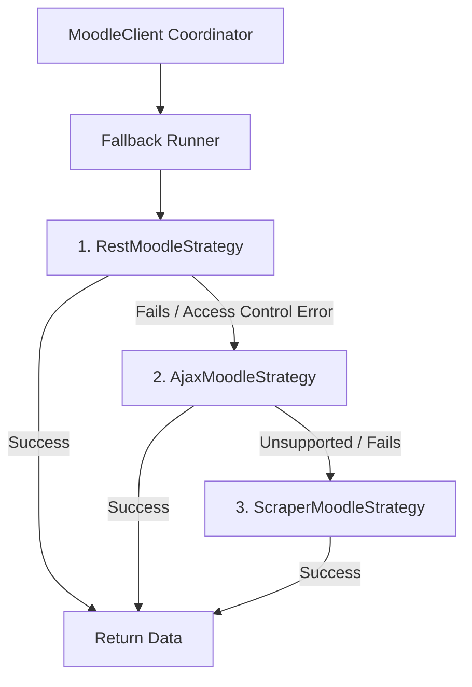
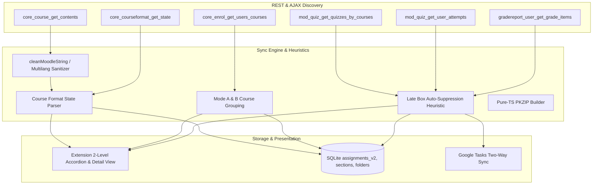
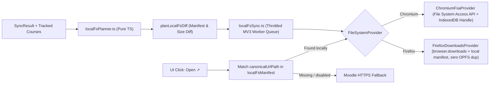

# Noodle — Architecture & Design Specifications

This document defines the system design, data isolation model, platform mechanics, and architectural rationale for the decentralized Noodle application.

---

## 1. System Architecture Overview

Noodle is built as a **fully decentralized, client-only application**. It does not routing requests through a centralized backend server, nor does it store user credentials in a shared cloud database. Instead, every user device (phone or browser) is its own independent API client.

```mermaid
graph TD
    subgraph User Device / Browser
        subgraph apps/extension (Chrome Extension)
            Pop[React Popup UI]
            Opt[React Options Page]
            SW[Service Worker - MV3]
            Loc[chrome.storage.local]
            SyncStore[chrome.storage.sync]
        end

        subgraph apps/mobile (Expo App)
            RN[React Native UI]
            SQL[(SQLite Database)]
            Sec[SecureStore]
            Fetch[Background Fetch Task]
        end

        subgraph packages/moodle-client (Shared Package)
            Engine[Sync Engine]
            Client[Moodle API Client]
            Parser[TAU Metadata Parser]
            GTasks[Google Tasks Sync]
        end
    end

    subgraph External Systems
        Moodle[moodle.tau.ac.il]
        Google[Google Tasks API]
    end

    %% Dependencies
    Pop --> SW
    Opt --> SW
    SW --> Engine
    Loc <--> SW
    SyncStore <--> SW

    RN --> Engine
    Fetch --> Engine
    SQL <--> RN
    SQL <--> Fetch
    Sec <--> RN
    Sec <--> Fetch

    Engine --> Client
    Engine --> Parser
    Engine --> GTasks

    Client -->|Direct HTTPS - CORS Bypass| Moodle
    GTasks -->|OAuth 2.0 REST| Google
```

---

## 2. Directory Layout & Monorepo Structure

The project utilizes a **pnpm workspaces monorepo** to share TypeScript code between the browser extension and the mobile application.

```
Noodle/
├── apps/
│   ├── mobile/                     # React Native + Expo mobile application
│   │   ├── src/
│   │   │   ├── app/                # Expo Router file-based routing (6-tab portrait / 5-tab landscape tablet)
│   │   │   ├── components/         # Native mobile UI components (incl. ColorPalettePickerModal, TrackedCoursesSection)
│   │   │   ├── constants/          # Theme tokens, pastel COURSE_COLOR_PALETTE, WCAG contrast utils
│   │   │   ├── hooks/              # AppState & responsive layout breakpoints
│   │   │   └── services/           # SQLite wrappers, nativeBridge, auth, fileDownloadService, notifications
│   │   └── android/.../NoodleNativeModule.kt  # OkHttp token launch, ACTION_CREATE_DOCUMENT, CookieManager bridge
│   │
│   └── extension/                  # Vite + React Chrome extension (Manifest V3)
│       ├── src/
│       │   ├── background/         # Service worker execution scripts
│       │   ├── popup/              # Compact quick-access popup SPA
│       │   └── options/            # Full options dashboard page SPA
│       └── public/                 # Manifest configuration and icons
│
├── packages/
│   └── moodle-client/              # Shared pure TypeScript API integration layer
│       ├── src/
│       │   ├── errors.ts           # MoodleApiError isolated from moodleApi.ts (zero Hermes require cycles)
│       │   ├── moodleApi.ts        # fetch()-based Moodle Web Service functions (re-exports MoodleApiError)
│       │   ├── syncEngine.ts       # Two-stage deterministic sync pipeline (contents -> activities/quizzes)
│       │   ├── syncProgress.ts     # Smart weighted monotonic sync progress engine (0-100%)
│       │   ├── courseFormatState.ts# 2-level section hierarchy & mod_subsection parser
│       │   ├── courseGrouping.ts   # Academic parent/sub-course & 5900* umbrella grouping
│       │   ├── zipBuilder.ts       # Pure-TS PKZIP archive builder for mod_folder downloads
│       │   ├── panoptoScraper.ts   # 3-tier Panopto folder discovery, session fetching & deduplication
│       │   └── courseParser.ts     # Regular expressions for TAU shortnames
│
└── legacy/                         # Archived Python FastAPI codebase (Reference only)
```

---

## 3. Core Architectural Components

### A. Shared Package (`packages/moodle-client`)
*   **Role:** Exposes data types, course parser regexes, API wrappers, and the core sync engine.
*   **Design Constraint:** Strictly environment-agnostic. It cannot import Node.js core libraries (e.g. `fs`, `crypto`) or browser-specific objects (like `window`). It relies entirely on standard JavaScript/TypeScript and the global `fetch()` web API. This ensures compiling and execution compatibility in both React Native (hermes/jsc engine) and Chrome Service Workers.

### B. Chrome Extension (`apps/extension`)
*   **Bundler:** Vite paired with the CRXJS plugin, which parses `manifest.json` to automatically compile background service worker files, assets, and popup HTML pages.
*   **CORS Bypass:** Bypasses Moodle's lack of CORS headers by declaring `*://moodle.tau.ac.il/*` in the manifest's `host_permissions` block. Target-specific store update check origins (`https://chromewebstore.google.com/*` + `https://clients2.google.com/*` for Chrome; `https://addons.mozilla.org/*` for Firefox) are scoped per target build in `apps/extension/vite.config.ts` so `src/shared/versionChecker.ts` can inspect store versions cleanly from the background worker.
*   **Ephemeral Service Worker Lifecycle & Message Passing:** Chrome MV3 Service Workers are designed to shut down after 30 seconds of inactivity. To prevent data corruption and connection drops:
    1.  No in-memory state is maintained globally across worker lifecycles.
    2.  State is fully restored from `chrome.storage.local` at the beginning of any event handler (alarm or message).
    3.  Message listeners (`chrome.runtime.onMessage`) are registered synchronously at the very top-level scope before alarms or async code, ensuring Chromium's C++ static event analyzer binds wake-up routes on cold boots.
    4.  Listeners accept `(message, sender, sendResponse)` and return `true` synchronously while invoking `sendResponse` upon promise completion, preserving the one-time messaging port across dormant wake-ups and eliminating `Could not establish connection. Receiving end does not exist` errors.
    5.  Alarms (`periodicSync`) are scheduled exclusively in `onInstalled` and `onStartup` guarded with `try/catch`, preventing unhandled promise rejections during worker evaluation.
    6.  A synchronization run checkpoints course progress incrementally. If the Service Worker is terminated mid-sync, the next alarm resumes from the last successfully synced course.

### C. Mobile App (`apps/mobile`)
*   **Framework:** Expo SDK 56 + React Native + Expo Router responsive cockpit (`onboarding.tsx`, `(tabs)/index`, `(tabs)/courses`, `(tabs)/assignments`, `(tabs)/recordings`, `(tabs)/grades`, `(tabs)/settings`, `course/[id].tsx`): phones and portrait tablets expose all 6 tabs (`Home -> Courses -> Assignments -> Recordings -> Grades -> Settings`) with a bubbling `PanResponder` horizontal swipe wrapper (`tabs-swipe-container`) that yields gesture priority to inner `RtlHorizontalScrollView` strips (`C2`), while landscape tablets (`isLandscapeTablet`) hide `(tabs)/courses` (`href: null` + `/courses` -> `/` redirect) and render `TrackedCoursesSection` directly on `Home` with a bottom-left sidebar collapse toggle (`E3`). Includes on-tap-while-syncing `SyncProgressBanner.tsx` with immediate completion dismiss (`E7`), `ColorPalettePickerModal.tsx` + 14-pastel `COURSE_COLOR_PALETTE` (`C4`), `MoodleFileRow.tsx` Open + Download actions (`E8` Share button removed), signature gradient CTAs & animations (`src/components/ui/NoodleAnimations.tsx`, `E1`/`E2`), and `fileDownloadService.ts` routing `downloadMoodleFile` / `downloadMoodleFolderZip` through Android's native `Intent.ACTION_CREATE_DOCUMENT` File Explorer (`saveFileWithSystemExplorerNative`, zero fallback on cancel, guaranteed `cleanupTempZip()`, and SAF/Sharing fallback only when unsupported, `C3`).
*   **RN/Hermes Compatibility (`packages/moodle-client/src/runtimeEnv.ts` & `errors.ts`):** Because React Native defines `window` without `document`, `isBrowserEnvironment()` checks `typeof document !== 'undefined'` and `navigator.product !== 'ReactNative'` so RN executes `CookieJar`, manual `3xx` hop-by-hop redirects, `cookieAdapter` hooks, and explicit `User-Agent: MoodleMobile` REST headers while bypassing browser CORS limits. `MoodleApiError` lives in `errors.ts` (`strategies/*.ts` use `import type` for `moodleApi.js`) to prevent Metro/Hermes require cycles (`E11`).
*   **Secure Storage, Native Bridge & WebView SSO (`NoodleNativeModule.kt`, `nativeBridge.ts`):** Sensitive credentials and `wstoken` are stored in `expo-secure-store` (with Web `localStorage`/memory fallback). `NoodleNativeModule` exposes `hasPanoptoAuthCookie` (paired with HTTPS `nidp.tau.ac.il`-guarded auto-login injection in `SsoWebViewModal.tsx`, `C1`), `saveFileWithSystemExplorer` (`Intent.ACTION_CREATE_DOCUMENT` + `BaseActivityEventListener` + `ioExecutor`, `C3`), and `fetchMoodleMobileTokenViaLaunch` (non-redirecting OkHttp + WebView `CookieManager` hybrid `CookieJar` capturing `moodlemobile://token=`, wired into `auth.ts` `loginTauSso`/`renewTokenSilently` and paired with `isTokenAuthError` + the top safe-area `"Session Expired — Reconnect"` banner in `app/_layout.tsx`, `C5`).
*   **SQLite Database & State Context:** `database.ts` wraps all multi-statement writes across `database.ts` and `settingsSyncService.ts` in re-entrant `runInTransaction(fn)` (`txDepth` guard preventing nested SQLite transaction crashes, `E10`), persists courses, `assignments` (`uid`, `cutoff_date`, `is_hidden`), `files`, `meetings`, `course_sections`, `course_folders`, `course_links`, `course_announcements`, `recordings`, `course_staff`, `grade_summaries`, and `preferences` in `noodle.db` (with an in-memory fallback on Web/Jest), and persists auto-discovered `coursesPanoptoMap` folder mappings (`persistDiscoveredPanoptoFolders` via `applyLocalSettingsPatch(..., false)`, `C1`), hydrated centrally via `AppStateProvider` (`use-app-state.tsx`) and `PreferencesProvider` (`use-preferences.tsx`).
*   **Cross-Device Sync (`settingsSyncService.ts`):** Synchronizes all 28 shared settings keys via `NOODLE_SYNC_DATA` (`deviceId: 'mobile-app'`), matching the extension's 60-minute default sync interval.

---

## 4. Platform Synchronization Mechanisms

### Browser Extension Periodic Sync
*   **Mechanism:** `chrome.alarms` API.
*   **Interval:** 60 minutes.
*   **Lifecycle:** The alarm wakes the Service Worker, which retrieves the Moodle token from `chrome.storage.local`, performs the full sync via the shared library, saves the output, and issues a native Chrome notification for any new deadlines.

### Mobile App Periodic Sync
*   **Mechanism:** `expo-background-fetch` + `expo-task-manager`.
*   **Interval:** OS-controlled.
*   **iOS Execution Behavior:** iOS limits background execution frequency depending on battery level, user behavior, and network conditions. Background tasks can run every 30-120 minutes and are capped at 30 seconds of execution. The sync engine is optimized to parallelize course requests to ensure completion within this tight window.
*   **Android Execution Behavior:** Android delegates background executions to a native `WorkManager` scheduler, offering highly consistent cron-like execution intervals.

---

## 5. Rationale & Trade-offs

| Design Decision | Advantages | Trade-offs / Challenges |
| :--- | :--- | :--- |
| **Monorepo (pnpm workspaces)** | Single repository, 100% logic reuse for Moodle Web Service calls, easy type synchronization. | Incremental build setups, config overhead for TypeScript compile paths. |
| **No Central Proxy Server** | Infinite scaling, zero hosting costs, absolute security compliance, immune to centralized IP blocking. | Client apps must perform OAuth logic themselves; no server to schedule reliable push notifications. |
| **Local SQLite on Mobile** | Blazing-fast UI rendering, complete offline read capability, simple data structures. | Requires database schema migration support when structural attributes change. |
| **MV3 Service Worker Sync** | Runs silently in the background of the browser, low power drain. | Service workers are terminated frequently, necessitating strict state serialization. |
| **Three-Tier Strategy Fallback** | Maximum resilience against university server/plugin changes; zero code changes needed when mobile app returns. | Maintaining multiple parsing/interaction adapters for REST, AJAX, and HTML. |

---

## 6. Moodle Client Modular Fallback Architecture

To handle university infrastructure changes (such as disabling the official Moodle Mobile web service or `tool_mobile` plugin), `packages/moodle-client` implements a Strategy Pattern with Chain-of-Responsibility fallback:



### Strategy Tiers:
1. **Tier 1 — REST Strategy (`RestMoodleStrategy`)**:
   Uses the official Moodle Mobile App web service (`/webservice/rest/server.php`) with the user's `wstoken`. This is the preferred, fastest, and most structured API. If this service is active, it runs with zero overhead.
   * **Multi-Instance REST Orchestrator**: TAU completely physically isolates databases for each academic year (e.g. `/2025/`). The root REST API timeline endpoint fails to query past courses, and the root `wstoken` is invalid on archive instances. To solve this, `RestMoodleStrategy` utilizes the user's active SSO cookies to silently follow the SAML SSO postback challenge on archive login endpoints (`/2025/login/index.php`), extracting a dedicated REST token for each archive year. It then orchestrates pure REST calls across all available instances and deduplicates the courses.
   * **1-Hour Circuit Breaker**: If Moodle responds with an access control exception (`accessexception`, `servicenotavailable`), `RestMoodleStrategy` trips a 1-hour circuit breaker cooldown (`markUnavailable(3600000)`). During this window, all calls skip REST immediately without firing HTTP requests or polluting logs.
2. **Tier 2 — AJAX Strategy (`AjaxMoodleStrategy`)**:
   Uses Moodle's internal AJAX endpoint (`/lib/ajax/service.php`) with the user's web `sesskey` and browser session cookie. Supports modern Moodle 4.x dashboard endpoints (e.g. `core_course_get_enrolled_courses_by_timeline_classification`).
   * **Static Operation Filtering**: Operations not exposed by Moodle core over AJAX (`getSiteInfo`, `getAssignments`, `getCourseContents`, `getGradeItems`, etc.) are declared statically via `isOperationSupported(op)`, allowing `fallbackRunner` to skip directly to Tier 3 without attempting doomed calls.
   * **Multi-Year Archive Querying**: Queries root and candidate past academic years (e.g. `/2025/lib/ajax/service.php`, `/2024/...`) with `sesskey`.
3. **Tier 3 — Scraper Strategy (`ScraperMoodleStrategy`) — *[Legacy / Unstable — Not a Target Handler]***:
   > **Architectural Policy**: Because Moodle's rendered HTML DOM varies drastically across course formats (`topics`, `onetopic`, `multitopic`, `grid`, `remuiformat`), themes (`tauboostunion`), and Moodle upgrades, `ScraperMoodleStrategy` is **very unstable and is NOT a relevant target handler for new features or Moodle structures**. All new synchronization features and Moodle structure parsers MUST rely exclusively on Moodle's structured JSON APIs: **Tier 1 REST (`RestMoodleStrategy`)** and, where supplementary web-only JSON state is needed (such as `core_courseformat_get_state`), **Tier 2 AJAX (`AjaxMoodleStrategy`)**.
   Acts like a standard browser, fetching rendered Moodle pages (`/grade/report/overview/index.php`, `/my/courses.php`, `/user/profile.php`, `/my/`, `/course/view.php?id=...`) with `credentials: 'include'`. Uses pure TypeScript string and regex parsing (fully compliant with Chrome MV3 Service Workers and React Native Hermes) to extract courses, assignment tables, modules, and files.

### Multi-Year Academic Archive Discovery:
Tel Aviv University maintains separate Moodle instances for each academic year (`https://moodle.tau.ac.il/` or `/2026/` for current/upcoming year, `/2025/` for the previous year, `/2024/`, etc.). During academic transitions (such as August–October before new semester enrollments open), the root instance often contains 0 enrolled courses while all active student coursework is located in past academic archives.
* **Dynamic Archive Discovery (`discoverArchiveYears`)**: `ScraperMoodleStrategy` parses root pages (`/`, `/my/`, `/grade/report/overview/index.php`) to dynamically discover year paths (`/(20\d{2})\b`) and archive dropdown selectors.
* **Candidate Year Probing**: Queries root and candidate past years (e.g. `2025`, `2024`) via `Promise.allSettled`, aggregating enrolled courses across all years.
* **Contextual Year Routing**: Tracks `courseYearMap` and `assignYearMap` so subsequent operations (`getCourseContents`, `getGradeItems`, `getSubmissionStatus`) and assignment deep links (`https://moodle.tau.ac.il/${year}/...`) automatically route to the correct academic year instance.

### Automatic Token Renewal on Expiry (D2 Fix):
To prevent silent degradation or unnecessary re-login prompts when the user's `wstoken` expires:
* **Detection**: `fallbackRunner.ts` intercepts `invalidtoken` and `accessexception` errors emitted by `RestMoodleStrategy`.
* **Silent Token Generation**: It calls `s.getMobileToken()` across strategies. `ScraperMoodleStrategy` utilizes the browser's active SSO cookies to send an authenticated POST to `/user/managetoken.php` with `action=resetwstoken`, parsing the freshly issued `wstoken` from `copytoclipboardtoken`.
* **State Synchronization & Instant Retry**: The newly acquired token is distributed to all strategies via `setToken()`, the REST circuit breaker cooldown is cleared, and the operation is retried via REST. The entire flow completes transparently in milliseconds.
* **Mobile Native Launch Renewal (`C5`)**: On React Native/Android, `auth.ts` (`loginTauSso`, `renewTokenSilently`) invokes `NoodleNativeModule.fetchMoodleMobileTokenViaLaunch` (non-redirecting OkHttp + WebView `CookieManager` `CookieJar` following `/admin/tool/mobile/launch.php` and SAML forms to extract `moodlemobile://token=`). If renewal fails when credentials are not stored, `use-app-state.tsx` + `app/_layout.tsx` display the `"Session Expired — Reconnect"` banner opening `SsoWebViewModal` (`mode="moodle"`).

### Direct Course-Page Assignment Discovery (D4 Fix):
To prevent missing past or unlisted assignments caused by calendar filtering:
* **Course Page Traversal**: `ScraperMoodleStrategy.getAssignments()` iterates over each course registered in `courseYearMap`.
* **DOM Scraping**: For each course URL (`${yearPrefix}/course/view.php?id=${courseId}`), it extracts anchor tags pointing to `/mod/assign/view.php?id=(\d+)` and parses the `.instancename` elements.
* **Full Data Integrity**: Guarantees that all active, submitted, past, or ungraded assignments visible to the student in course sections are discovered without being constrained by calendar upcoming event date windows.

### Observability in DevMode:
When `devMode: true` is enabled, the coordinator logs every strategy attempt, unsupported function skip, failure reason, and successful fallback transition to the developer console for transparent debugging.

---

## 7. Zoom Meeting Architecture & Lifecycle

### Multi-Modal Meeting Discovery
Moodle courses configure Zoom sessions using disparate modules across departments. Noodle captures all variations without fragile heuristics:
1. **Zoom LTI Pro Modules (`modname === 'lti'`)**:
   Calls Moodle WS `mod_lti_get_tool_launch_data` with the user's `wstoken` to get official LTI launch parameters and query Zoom LTI Pro API endpoints (`applications.zoom.us/api/v1/lti/rich/meeting/upComing`). Extracts meeting topics, exact join links, meeting numbers, passcodes, and ISO start timestamps. Falls back to Moodle LTI view page if tool launch data fails.
2. **Official Zoom Modules (`modname === 'zoom'`)**:
   Inspects `contents` and URL attributes for direct Zoom room links.
3. **URL Modules (`modname === 'url'`)**:
   Matches direct Zoom URLs or Hebrew videoconferencing keywords ("קישור לזום", "מפגש מקוון", "שיעור זום", "היוועדות חזותית", "כיתה וירטואלית").
4. **Embedded HTML Links (`label`, `page`, section summaries)**:
   Scans inner HTML for `<a href="...">` and raw URLs pointing to `*.zoom.us/j/*` or `/my/*`.

### Recurring Meeting Collapsing, Timestamp Sanitization & Uncluttered UI
Courses with multiple lecture/recitation groups or repeating weekly meetings generate 10+ entries in Moodle.
* **Timestamp Sanitization (`normalizeZoomStartTime`)**: Zoom LTI Pro returns room creation timestamps (often months old with arbitrary hours/minutes/seconds) for "No Fixed Time" recurring rooms (`type === 3`), instant meetings (`type === 1`), and PMI rooms (`type === 4`). `normalizeZoomStartTime` strips these creation timestamps so permanent rooms do not display bogus dates/hours.
* **`collapseRecurringMeetings` Engine**: Collapses recurring series sharing the same room into a single entry representing the currently active session (`startTime <= now <= startTime + 2h`), the nearest upcoming session, or the latest past session if all ended.
* **Uncluttered UI Partitioning**: Dashboard course cards and Course Detail views render only visible sessions by default.
* **Collapsible "Show Hidden" Toggle**: Users can expand hidden sessions with one click to adjust selections.
* **Course-Level Bulk Actions**: Single-click "הצג הכל" (Show all) and "הסתר הכל" (Hide all) allow students to configure 10+ group instances in two clicks without polluting other courses.

---

## 8. Cross-Browser Extension Build Architecture

To guarantee strict parity between Chromium and Firefox while preventing runtime manifest corruption:
* **Output Directory Separation**:
  - Chrome / Chromium: Outputs to `apps/extension/dist/`. Uses Manifest V3 with `"background": { "service_worker": "...", "type": "module" }`.
  - Firefox: Outputs to `apps/extension/dist-firefox/`. Uses Manifest V3 with `"background": { "scripts": ["..."], "type": "module" }` and `browser_specific_settings.gecko`.
* **Zero Collision**:
  - Automated parity tests (`scripts/test-build-parity.mjs`) and manual builds compile each target into its dedicated output folder.
  - Chromium never encounters Firefox's `background.scripts` array (which causes Chrome to omit registering the service worker and reject all runtime messages with `Could not establish connection. Receiving end does not exist`).

---

## 9. Google Tasks Two-Way Sync & Deletion Architecture

To ensure the student's Google Tasks list operates as a clean, actionable to-do list rather than an archive of finished or dismissed work:
* **Strict Exclusion of Hidden Tasks**:
  - Any assignment present in `hiddenAssignments` (or with `isHidden: true`) is completely skipped during task creation and updates.
  - If a task matching a hidden assignment already exists in Google Tasks, Noodle immediately issues a `DELETE` request to remove it.
* **Deletion of Completed & Marked-Done Tasks**:
  - Assignments that are submitted in Moodle, marked done in Noodle (`completedAssignments`), or completed directly in Google Tasks (`status: 'completed'`) are purged from the task list via `DELETE`.
  - This eliminates stale completed items from cluttering the user's Google Tasks interface.
* **Active Tasks Synchronization**:
  - Only active, uncompleted, non-hidden assignments are pushed to Google Tasks with `status: 'needsAction'` and formatted due dates.
  - If an assignment was submitted but the student explicitly flagged it as "To Do" (`uncompletedAssignments`), it remains active in Google Tasks.
* **Orphaned Task Purging with Personal Task Isolation**:
  - Noodle scans for tasks tagged with `Noodle:assignId:{id}`. Any tagged task whose assignment is no longer tracked or active is deleted.
    - Personal tasks created manually by the user in the same list (lacking Noodle metadata) are strictly untouched.
* **Cross-Browser OAuth 2.0 Redirection & RFC 8252 Loopback Architecture**:
  - **Chromium**: Uses `https://<chrome_extension_id>.chromiumapp.org/` registered under a Chrome App OAuth Client ID.
  - **Firefox**: `browser.identity.getRedirectURL()` generates `https://<subdomain>.extensions.allizom.org/`. Google Cloud Console enforces top-level domain verification for HTTPS web origins, making it impossible to register Mozilla's `allizom.org` domain.
  - To comply with OAuth 2.0 for Native Apps ([RFC 8252 Section 7.3](https://datatracker.ietf.org/doc/html/rfc8252#section-7.3)), Firefox 86+ natively intercepts the loopback address `http://127.0.0.1/mozoauth2/<subdomain>`.
  - The shared helper `getGoogleOAuthRedirectUrl()` inspects the environment and automatically transforms any `.extensions.allizom.org` redirect URL into `http://127.0.0.1/mozoauth2/<subdomain>`, which Google Cloud Console allows on OAuth 2.0 Web Client credentials without domain verification.

---

## 10. Web Showcase & Gateway Hosting Architecture

Noodle's public web showcase (`website/`) is hosted via the **Mantin Server Gateway** infrastructure:
- **Routing Engine**: Nginx-based multi-site reverse router (`static-router`) deployed inside `app-gateway-net`.
- **Public Domain**: `noodle.mantin.dev` configured as a CNAME pointing to Cloudflare Tunnel (`ea794643-cdf3-4780-91be-a93ca5756d44.cfargotunnel.com`).
- **Cloudflare Ingress Target**: Points to `http://static-router:80` with the `Host: noodle.mantin.dev` header preserved.
- **Mount Pipeline**: Bind mounts `/home/mantin-server/Noodle/website` into `/usr/share/nginx/html/noodle:ro` allowing real-time static asset delivery without build or duplication overhead.

---

## 11. Moodle Hierarchical Structures & Heuristics Architecture

To fully represent Tel Aviv University's complex Moodle environments without relying on fragile HTML scraping, Noodle incorporates structured hierarchical models and heuristics:



### 1. Academic Parent/Sub-Course Grouping (Mode A) & Administrative Umbrella (Mode B)
* **Mode A (Academic Courses)**: Departments frequently split a course into an 8-digit lecture portal (e.g. `01022312` or `-99-`) and a 10-digit group/recitation portal (e.g. `0102231201`). Noodle pairs and aggregates them into a single high-level course card, merging section hierarchies, assignments, quizzes, and files while preserving the underlying `sourceCourseId` for API deep links.
* **Mode B (Administrative Umbrella)**: Compliance and safety tutorials (such as `5900*`, `5800*`, or categorized under `בטיחות` / `Safety`) are grouped into a dedicated administrative card (`הדרכות בטיחות והדרכות חובה`) and excluded from academic GPA calculations (`excludeFromGpa: true`).

### 2. Format-Aware 2-Level Section Hierarchy (`courseFormatState.ts`)
Moodle courses in TAU utilize advanced course formats (`multitopic` and `onetopic`) alongside Moodle 4.5 nested subsections:
* **AJAX Inspection**: Queries `core_courseformat_get_state` using the active `sesskey`.
* **Tree Reconstruction**: Parses `tabsdata` subtrees in `multitopic` courses and `parentid` / `levelsan` attributes in `onetopic` courses, structuring sections into top-level tabs (`level: 0`) and nested sub-topics (`level: 1`) with parent linkage.
* **Moodle 4.5 Sub-Sections**: Native `mod_subsection` sub-components are extracted and mapped directly into child sections with format-aware URL hashes.

### 3. Quizzes (`mod_quiz`) & Two-Way Interactive Completion Sync
* **Full Parity**: Quizzes and online exams are elevated to first-class citizens alongside assignments in the unified `Assignment` schema with composite UIDs (`quiz:ID` vs `assign:ID`).
* **Availability & Restrictions**: Extracts `timelimit` (duration restriction in seconds), `timeopen`, `timeclose`, and allowed attempt counts.
* **Two-Way Completion Sync**: When an activity specifies manual completion tracking (`completion === 1`), clicking "Mark as done" directly dispatches `core_completion_update_activity_completion_status_manually` to the Moodle server.

### 4. Heuristics: Late-Submission Box Auto-Suppression & Bonus Heuristic
* **Late-Submission Box Pairing**: TAU professors routinely maintain a second submission box labeled `הגשה באיחור` or `תיבת הגשה באיחור`. Noodle's sync engine pairs late boxes with their base assignments; if the student has already submitted the regular assignment, the late box is automatically suppressed (`isHidden: true`) to keep the dashboard uncluttered.
* **Bonus Identification**: Grade items and assignments with `grademax <= 5` or carrying the keyword `בונוס` / `bonus` are automatically flagged with `isBonus: true`.

---

## 12. Local Filesystem Sync Architecture (`Issue #18`)

Noodle optionally mirrors Moodle course materials, folders, and assignments directly onto the student's computer while remaining cross-browser compatible and immune to redundant disk usage or Moodle rate-limiting:



### Key Architectural Guarantees
1. **Browser-Agnostic `FileSystemProvider` Strategy (`apps/extension/src/services/fs/`)**:
   - **Chromium (`ChromiumFsaProvider`)**: Uses the File System Access API (`window.showDirectoryPicker({ mode: 'readwrite' })`), persists the `FileSystemDirectoryHandle` across sessions in IndexedDB (`NoodleLocalFsDB`), streams HTTP `ReadableStream` bodies through a byte-counting/aborting `TransformStream` into `FileSystemWritableFileStream` without RAM buffering, maps `NotAllowedError`/`SecurityError` consistently into `LocalFsPermissionError`, and opens local files instantaneously via `URL.createObjectURL(file)` (`blob:` tabs). Zero extra Chrome permissions required.
   - **Firefox (`FirefoxDownloadsProvider`)**: Writes strictly via single-pass `browser.downloads.download({ url, filename: '<rootSubfolder>/<relativePath>', conflictAction: 'overwrite', saveAs: false })` using the authenticated Moodle HTTPS URL (never ephemeral `blob:` URLs and zero duplicate HTTP GET preflights), intercepting oversized (`maxBytes`), `text/html`/small non-`.json` `application/json`/SAML redirects, and `SERVER_UNAUTHORIZED`/`SERVER_FORBIDDEN` failures cleanly before a 1-shot `reauthenticate()` retry. Tracks `downloadId` + `origin` in `browser.storage.local` without duplicating gigabytes of PDFs in OPFS, reconciles stale/rotated session `downloadId`s strictly against `expectedFilename` via `LOCAL_FS_RECONCILE` -> `reconcileManifestDetailed()`, and opens local downloads synchronously via `browser.downloads.open(downloadId)` (rendering scanned/`rclone` entries without a `downloadId` as blue Web actions with explanatory tooltips). Firefox-only permissions (`"downloads"`, `"downloads.open"`) are injected exclusively during `vite build --mode firefox`.
2. **Deterministic Pure-TS Planning & Sanitization (`packages/moodle-client/src/localFsPlanner.ts`)**:
   - Excludes `mod_folder` child items from `files[]` (`!f.folderId`, matching `CR-09`) so folder files download exclusively under `<Course>/<Section>/<FolderName>/<relativePath>`.
   - Filters course trees by `trackedCourseIds`, pre-seeds `usedCourseFoldersLower` from `existingCourseFolderNames` before assigning new course directories, merges parent/recitation sub-courses (Mode A) cleanly into unified course directories, sanitizes forbidden OS characters, guards Windows reserved filenames (`CON`, `PRN`, `AUX`, `NUL`, `COM1..9`, `LPT1..9`), compacts oversized paths within `210` chars, and disambiguates collisions (`file (2).pdf`).
3. **Serialized MV3 Queue, Pause/Resume Coordination & Auth Guards (`apps/extension/src/background/localFsSync.ts`)**:
   - All storage/queue mutations serialize behind `withStateLock` + `mutationEpoch`/`controlEpoch` guards (suppressing commits for items evicted mid-flight), queue/manifest/orphan-log pruning keeps `totalQueued === completedInCycle + pendingCount`, and `pauseLocalFsSync()` / `resumeLocalFsSync()` coordinate `abortableSleep()` (MV3-safe sliced waits <=7.5s) and `LOCAL_FS_RESUME_ALARM` without racing or wiping cycle counters. Retains `safe` / `moderate` profiles, exponential backoff, 15-minute cooldown circuit breaker, and HTML/bounded-JSON/SAML error interception.
4. **Opt-In Deletion Respect, Tri-State Presence & Strict Machine-Local State**:
   - Off by default (`enabled: false`), excluded from `NOODLE_SYNC_DATA` cloud settings sync, and suppresses immediate auto-download on Firefox enable until Scan/`Sync Now` runs; changing the Firefox subfolder requests confirmation before clearing local tracking.
   - Before queueing `'new'` files when `localFsManifest` is empty (e.g. after extension reinstall), `adoptExistingFiles()` checks existing files on disk (`ChromiumFsaProvider`) or Firefox's completed download history (`FirefoxDownloadsProvider`) so unchanged files already on disk are adopted into the manifest without re-downloading. Firefox Settings also includes a `<input webkitdirectory>` **Scan existing folder** tool (`LOCAL_FS_ADOPT_SCANNED`) for adopting pre-synced folders (e.g. `rclone` or cleared browser history).
   - Tri-state `checkFilePresence()` / `batchCheckFilePresence()` distinguishes `'present'`, `'missing'`, and `'unverifiable'` so when `autoResyncMissingFiles` is enabled, deleted tracked downloads are re-fetched while scanned/`rclone` and purged-history entries are never spuriously re-downloaded.
   - `LOGOUT` clears `localFsConfig`, `localFsManifest`, `localFsQueue`, `localFsStatus`, and IndexedDB directory handle without erasing files already stored on the user's filesystem.
