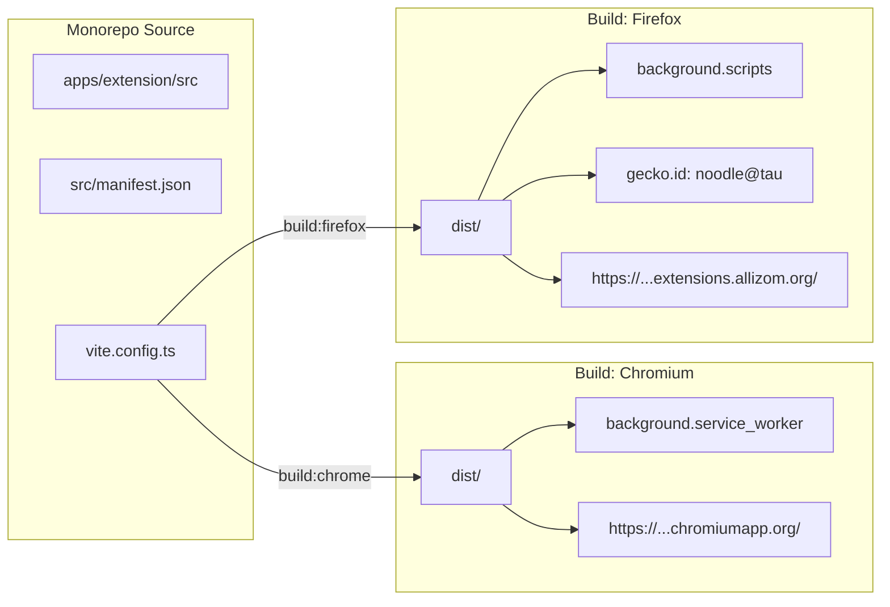

# Noodle — Master System Test Cases Catalog

This document is the authoritative test catalog for **Noodle**. It is designed specifically for **AI Coding Agents** and **QA Developers** to understand, implement, and verify tests across the entire monorepo:
* **Browser Extension** (`apps/extension`): Tested on both **Chromium** (Google Chrome, Brave, Edge) and **Firefox** (Gecko)
* **Mobile App** (`apps/mobile`): Tested on iOS, Android, and Expo Web
* **Shared Client Core** (`packages/moodle-client`): Pure TypeScript shared engine

---

## 1. Agent Testing Guide & Target Platforms

Every test case in this catalog defines its target platform and testing modality:

### A. Testing Modalities

#### 1. Automated Testing (`Automated`)
* **Definition**: Programmatic, headless tests executed via CLI or CI/CD pipelines.
* **Test Runners**:
  * **Unit & Parser Tests**: `jest` in `packages/moodle-client` (`pnpm --filter @tautracker/moodle-client test`).
  * **Extension Tests**: Vitest / Playwright headless with Chromium and Firefox contexts (`playwright.chromium` and `playwright.firefox`).
  * **Mobile Tests**: Jest / React Native Testing Library in `apps/mobile`.
* **Agent Role**: Write test files, mock network responses (`fetch`, `chrome.*`, `browser.*`, `expo-*`), execute test commands, and assert outputs.

#### 2. Gemini Browser Interaction Agent Testing (`Browser Agent`)
* **Definition**: Interactive, manual-style testing performed by an AI Agent equipped with browser interaction tools (Chrome DevTools Protocol, Playwright sessions, or Gemini `/browser` commands).
* **Target Contexts**:
  * **Chromium Extension Dev**: Launched via `pnpm --filter extension run dev` or unpacked from `apps/extension/dist`.
  * **Firefox Extension Dev**: Launched via `pnpm --filter extension run dev:firefox` or loaded as temporary add-on via `about:debugging` from `apps/extension/dist`.
  * **Mobile Web Client**: Launched via `pnpm --filter mobile run web` (available at `http://localhost:8081`).
* **Agent Role**: Launch browser session, interact with UI controls, verify layout responses in Hebrew (RTL) and English (LTR), validate modal dialogs, and inspect local storage/cookies.

---

### B. Platform & Browser Target Key

| Platform Identifier | Meaning & Scope |
| :--- | :--- |
| **`All (Mobile + Chrome + Firefox)`** | Must function identically across the Mobile App and both extension targets (Chromium & Firefox). |
| **`Extension (Chrome & Firefox)`** | Desktop browser extension feature; must pass on both Chromium (MV3 Service Worker) and Firefox (MV3 Scripts). |
| **`Extension (Chromium Specific)`** | Tests Chromium-exclusive behaviors (Chrome MV3 ephemeral service worker 30s idle lifecycle, `chromiumapp.org` OAuth). |
| **`Extension (Firefox Specific)`** | Tests Firefox/Gecko-exclusive behaviors (`background.scripts`, Gecko ID `noodle@tau`, Total Cookie Protection). |
| **`Mobile Only`** | Mobile app feature relying on native React Native / Expo hardware APIs (SQLite, SecureStore, Sharing, etc.). |

---

### C. Extension Architecture Differences: Chromium vs. Firefox

Agents implementing or testing extension features must account for the following engine variations:

1. **Manifest Background Declaration**:
   * **Chromium**: Uses `"background": { "service_worker": "src/background/serviceWorker.ts", "type": "module" }`. Service worker is ephemeral and shuts down after 30 seconds of inactivity.
   * **Firefox**: In `vite.config.ts`, `manifest.background.service_worker` is converted to `manifest.background.scripts = [...]`. Runs as an event page script under Gecko.
2. **Browser Extension Polyfill**:
   * Code uses `import browser from 'webextension-polyfill'` to normalize `chrome.*` and `browser.*` APIs.
3. **Google OAuth Redirect URLs**:
   * **Chromium**: `https://<extension-id>.chromiumapp.org/`.
   * **Firefox**: `browser.identity.getRedirectURL()` resolves to `https://<extension-id>.extensions.allizom.org/`.
4. **Cookie APIs & Partitioning**:
   * Firefox uses **Total Cookie Protection (dFPI)**, which partitions cookies by top-level site. Clearing cookies on logout requires sweeping all partition stores.
5. **Commands for Extension Dev & Build**:
   * **Chromium Dev**: `pnpm --filter extension run dev`
   * **Firefox Dev**: `pnpm --filter extension run dev:firefox`
   * **Chromium Build**: `pnpm --filter extension run build:chrome`
   * **Firefox Build**: `pnpm --filter extension run build:firefox`

---

## 2. Quick Reference Matrix

| ID | Feature / Action | Platform Target | Modality | Category |
| :--- | :--- | :--- | :--- | :--- |
| **TC-AUTH-01** | TAU SSO Login Redirect Chain | All (Mobile + Chrome + Firefox) | Automated & Browser Agent | Auth & Session |
| **TC-AUTH-02** | Israeli ID Mod-10 Validation | All (Mobile + Chrome + Firefox) | Automated & Browser Agent | Auth & Session |
| **TC-AUTH-03** | Invalid Credentials Error Handling | All (Mobile + Chrome + Firefox) | Automated & Browser Agent | Auth & Session |
| **TC-AUTH-04** | "Remember Me" Credential Persistence | All (Mobile + Chrome + Firefox) | Automated & Browser Agent | Auth & Session |
| **TC-AUTH-05** | Silent Re-Authentication on Token Expiry | All (Mobile + Chrome + Firefox) | Automated | Auth & Session |
| **TC-AUTH-06** | Full User Session Teardown & Logout | All (Mobile + Chrome + Firefox) | Automated & Browser Agent | Auth & Session |
| **TC-AUTH-07** | Browser Cookie Cleansing on Logout | Extension (Chrome & Firefox) | Automated & Browser Agent | Auth & Session |
| **TC-AUTH-08** | WebRequest Token Interception | Extension (Chrome & Firefox) | Automated & Browser Agent | Auth & Session |
| **TC-CRS-01** | Fetch Enrolled Courses | All (Mobile + Chrome + Firefox) | Automated | Courses |
| **TC-CRS-02** | Semester Parsing & Academic Grouping | All (Mobile + Chrome + Firefox) | Automated & Browser Agent | Courses |
| **TC-CRS-03** | Course Tracking Toggle (`is_active`) | All (Mobile + Chrome + Firefox) | Automated & Browser Agent | Courses |
| **TC-CRS-04** | Custom Course Nickname Editing | All (Mobile + Chrome + Firefox) | Automated & Browser Agent | Courses |
| **TC-CRS-05** | Course Color Swatch & Hex Picker | All (Mobile + Chrome + Firefox) | Automated & Browser Agent | Courses |
| **TC-CRS-06** | Course Search & Real-Time Filtering | All (Mobile + Chrome + Firefox) | Automated & Browser Agent | Courses |
| **TC-CRS-07** | Direct Moodle Course Link Launch | All (Mobile + Chrome + Firefox) | Browser Agent | Courses |
| **TC-CRS-08** | Laboratory Course Assignment Hiding Prompt | All (Mobile + Chrome + Firefox) | Automated & Browser Agent | Courses |
| **TC-ASN-01** | Aggregated Chronological Assignment Feed | All (Mobile + Chrome + Firefox) | Automated & Browser Agent | Dashboard |
| **TC-ASN-02** | Proximity Urgency Badges & Colors | All (Mobile + Chrome + Firefox) | Automated & Browser Agent | Dashboard |
| **TC-ASN-03** | Submission Status & Grade Pill | All (Mobile + Chrome + Firefox) | Automated & Browser Agent | Dashboard |
| **TC-ASN-04** | Manual Completion Toggle (Override) | All (Mobile + Chrome + Firefox) | Automated & Browser Agent | Dashboard |
| **TC-ASN-05** | Hide & Unhide Assignments | All (Mobile + Chrome + Firefox) | Automated & Browser Agent | Dashboard |
| **TC-ASN-06** | Status Filter Tabs (Pending/Past/Done/Hidden) | All (Mobile + Chrome + Firefox) | Automated & Browser Agent | Assignments |
| **TC-ASN-07** | Global Assignment & Course Text Search | All (Mobile + Chrome + Firefox) | Automated & Browser Agent | Assignments |
| **TC-ASN-08** | In-Place Subject & Material Accordion | All (Mobile + Chrome + Firefox) | Automated & Browser Agent | Assignments |
| **TC-ASN-09** | Course-Specific Filter Banner & Deep Navigation | All (Mobile + Chrome + Firefox) | Automated & Browser Agent | Assignments |
| **TC-ASN-10** | "Next Up" Urgent Deadline Banner | All (Mobile + Chrome + Firefox) | Automated & Browser Agent | Dashboard |
| **TC-ASN-11** | Pull-to-Refresh Gesture | Mobile Only | Browser Agent | Dashboard |
| **TC-ASN-12** | Assignments Split-Pane Calendar View & Deep Item Selection | Extension (Chrome & Firefox) | Automated & Browser Agent | Assignments |
| **TC-DASH-REHAUL-01** | Tracked Course Card Row Expansion (Zoom & 5 Assignments) | Extension (Chrome & Firefox) | Automated & Browser Agent | Dashboard |
| **TC-DASH-REHAUL-02** | Upcoming To-Do Queue Item Filtering & Drawer Expansion | Extension (Chrome & Firefox) | Automated & Browser Agent | Dashboard |
| **TC-DASH-REHAUL-03** | Manage Courses Modal Dialog & Semester Partitioning | Extension (Chrome & Firefox) | Automated & Browser Agent | Dashboard |
| **TC-DASH-REHAUL-04** | Dark Noodle "Coffee" Theme Visual Verification | Extension (Chrome & Firefox) | Automated & Browser Agent | Theming |
| **TC-DASH-REHAUL-05** | Settings Mock Course Sandbox Generation & Multi-State Data | Extension (Chrome & Firefox) | Automated & Browser Agent | Settings / Sandbox |
| **TC-DASH-REHAUL-06** | Zoom Meeting Unhide & Direct Action Controls | Extension (Chrome & Firefox) | Automated & Browser Agent | Dashboard |
| **TC-DASH-REHAUL-07** | Squircle File Buttons & Arrow-Only Download Action | Extension (Chrome & Firefox) | Automated & Browser Agent | UI Components |
| **TC-DASH-REHAUL-08** | Deterministic Sync Order & Undated Task Stability | All (Mobile + Chrome + Firefox) | Automated | Sync Engine |
| **TC-DASH-REHAUL-09** | Course Page Grid Containment & No Frame Overflow | Extension (Chrome & Firefox) | Automated & Browser Agent | Course Detail |
| **TC-DET-01** | Horizontal Topic / Section Pill Bar | All (Mobile + Chrome + Firefox) | Browser Agent | Course Detail |
| **TC-DET-02** | Expand / Collapse All Sections | All (Mobile + Chrome + Firefox) | Browser Agent | Course Detail |
| **TC-DET-03** | Course Statistics Summary Banner | All (Mobile + Chrome + Firefox) | Automated & Browser Agent | Course Detail |
| **TC-DET-04** | Section Materials & Attachments | All (Mobile + Chrome + Firefox) | Automated & Browser Agent | Course Detail |
| **TC-DET-05** | Course Detail "Hide All" Toggle & Dual File Actions | Extension (Chrome & Firefox) | Automated & Browser Agent | Course Detail |
| **TC-ZM-01** | Zoom Module & Schedule Scraping | All (Mobile + Chrome + Firefox) | Automated | Zoom Meetings |
| **TC-ZM-02** | Active Meeting Detection (`● פעיל כעת`) | All (Mobile + Chrome + Firefox) | Automated & Browser Agent | Zoom Meetings |
| **TC-ZM-03** | Zoom Meeting Interest / Favorite Toggle | All (Mobile + Chrome + Firefox) | Automated & Browser Agent | Zoom Meetings |
| **TC-ZM-04** | One-Tap Join Zoom Meeting | All (Mobile + Chrome + Firefox) | Browser Agent | Zoom Meetings |
| **TC-ZM-05** | Multi-Modal Zoom Link Extraction & Deduplication | All (Mobile + Chrome + Firefox) | Automated | Zoom Meetings |
| **TC-ZM-06** | Recurring Zoom Session Collapsing, Uncluttered Panel & Show-Hidden Toggle | All (Mobile + Chrome + Firefox) | Automated & Browser Agent | Zoom Meetings |
| **TC-FILE-01** | Aggregated Course Files Tree | All (Mobile + Chrome + Firefox) | Automated & Browser Agent | Files Explorer |
| **TC-FILE-02** | File Search by Keyword & Extension | All (Mobile + Chrome + Firefox) | Automated & Browser Agent | Files Explorer |
| **TC-FILE-03** | File-Type Badges & Size Formatting | All (Mobile + Chrome + Firefox) | Automated & Browser Agent | Files Explorer |
| **TC-FILE-04** | Authenticated Download with WAF Bypass | All (Mobile + Chrome + Firefox) | Automated | Files Explorer |
| **TC-FILE-05** | Native Document Sharing Sheet | Mobile Only | Browser Agent | Files Explorer |
| **TC-FILE-06** | Dual-Engine Buffer vs Legacy Download | Mobile Only | Automated | Files Explorer |
| **TC-GRD-01** | Grade Items Query & Parsing | All (Mobile + Chrome + Firefox) | Automated | Grades & GPA |
| **TC-GRD-02** | Graded Assignment Item Breakdown | All (Mobile + Chrome + Firefox) | Automated & Browser Agent | Grades & GPA |
| **TC-GRD-03** | Course Average & Overall GPA Calculation | All (Mobile + Chrome + Firefox) | Automated & Browser Agent | Grades & GPA |
| **TC-GRD-04** | Empty Grades Placeholder State | All (Mobile + Chrome + Firefox) | Browser Agent | Grades & GPA |
| **TC-GT-01** | Google OAuth 2.0 Authorization Flow | All (Mobile + Chrome + Firefox) | Automated & Browser Agent | Google Tasks |
| **TC-GT-02** | Automatic "Noodle" Task List Provisioning | All (Mobile + Chrome + Firefox) | Automated | Google Tasks |
| **TC-GT-03** | Assignment Mapping to Task Format | All (Mobile + Chrome + Firefox) | Automated | Google Tasks |
| **TC-GT-04** | Idempotent Tag Injection (`Noodle:assignId`) | All (Mobile + Chrome + Firefox) | Automated | Google Tasks |
| **TC-GT-05** | Completed Task Deletion from Google Tasks | All (Mobile + Chrome + Firefox) | Automated | Google Tasks |
| **TC-GT-06** | Hidden Task Exclusion & Google Tasks Deletion | All (Mobile + Chrome + Firefox) | Automated | Google Tasks |
| **TC-GT-07** | Manual Google Tasks Sync Trigger | All (Mobile + Chrome + Firefox) | Automated & Browser Agent | Google Tasks |
| **TC-GT-08** | Assignments Without Deadline Sync Setting & Deletion Logic | All (Mobile + Chrome + Firefox) | Automated & Browser Agent | Google Tasks |
| **TC-GT-09** | Persistent Auth, Silent Refresh & Unauthenticated Sync Alert | All (Mobile + Chrome + Firefox) | Automated & Browser Agent | Google Tasks |
| **TC-SYNC-01** | Serialize Settings to Calendar Event | All (Mobile + Chrome + Firefox) | Automated | Cross-Device Sync |
| **TC-SYNC-02** | Remote Settings Pull & LWW Merge | All (Mobile + Chrome + Firefox) | Automated | Cross-Device Sync |
| **TC-SYNC-03** | Cross-Client Settings Reflection | All (Mobile + Chrome + Firefox) | Automated & Browser Agent | Cross-Device Sync |
| **TC-BCK-01** | Export `TauTrackerConfig-v1` JSON | All (Mobile + Chrome + Firefox) | Automated & Browser Agent | Backup & Restore |
| **TC-BCK-02** | Import & Validate Backup JSON | All (Mobile + Chrome + Firefox) | Automated & Browser Agent | Backup & Restore |
| **TC-BCK-03** | Native Sharing Sheet Export | Mobile Only | Browser Agent | Backup & Restore |
| **TC-BCK-04** | Native Document Picker Import | Mobile Only | Browser Agent | Backup & Restore |
| **TC-BCK-05** | Direct Browser File Download Export | Extension (Chrome & Firefox) | Browser Agent | Backup & Restore |
| **TC-UI-01** | Hebrew (RTL) vs English (LTR) Toggle | All (Mobile + Chrome + Firefox) | Automated & Browser Agent | Localization & Theme |
| **TC-UI-02** | Slate Dark vs Warm Cream Noodle Theme | All (Mobile + Chrome + Firefox) | Browser Agent | Localization & Theme |
| **TC-UI-03** | Reactive Theme/Language Update (No Reload) | All (Mobile + Chrome + Firefox) | Browser Agent | Localization & Theme |
| **TC-UI-04** | Custom Urgency Days Thresholds | All (Mobile + Chrome + Firefox) | Automated & Browser Agent | Localization & Theme |
| **TC-UI-05** | Account Section Links & Elaborated About Page Experience | All (Mobile + Chrome + Firefox) | Browser Agent | Localization & Theme |
| **TC-BG-01** | Recurring Background Sync Alarm / Task | All (Mobile + Chrome + Firefox) | Automated | Background Sync |
| **TC-BG-02** | New Assignment Discovery Notification | All (Mobile + Chrome + Firefox) | Automated & Browser Agent | Background Sync |
| **TC-BG-03** | 24-Hour and 1-Hour Deadline Alerts | All (Mobile + Chrome + Firefox) | Automated & Browser Agent | Background Sync |
| **TC-BG-04** | Notification Permission Handshake | All (Mobile + Chrome + Firefox) | Browser Agent | Background Sync |
| **TC-BG-05** | Toolbar Icon Badge Count | Extension (Chrome & Firefox) | Automated & Browser Agent | Extension Specials |
| **TC-EXT-01** | Toolbar Popup Quick-Access View | Extension (Chrome & Firefox) | Browser Agent | Extension Specials |
| **TC-EXT-02** | Collapsible Sidebar (240px to 72px) | Extension (Chrome & Firefox) | Browser Agent | Extension Specials |
| **TC-EXT-03** | First-Time Interactive Onboarding Tour | Extension (Chrome & Firefox) | Browser Agent | Extension Specials |
| **TC-EXT-04** | Options Dashboard React Hook Invariant Parity | Extension (Chrome & Firefox) | Automated | Extension Specials |
| **TC-EXT-BRW-01** | Manifest Build Transformation Parity | Extension (Chrome & Firefox) | Automated | Cross-Browser |
| **TC-EXT-BRW-02** | OAuth Redirect URI Resolution Parity | Extension (Chrome & Firefox) | Automated & Browser Agent | Cross-Browser |
| **TC-EXT-BRW-03** | Gecko Protocol Interception Parity | Extension (Firefox Specific) | Automated & Browser Agent | Cross-Browser |
| **TC-EXT-BRW-04** | Firefox Total Cookie Protection Logout | Extension (Firefox Specific) | Automated & Browser Agent | Cross-Browser |
| **TC-EXT-BRW-05** | MV3 Ephemeral Service Worker Lifecycle | Extension (Chromium Specific)| Automated | Cross-Browser |
| **TC-EXT-BRW-06** | MV3 Dormant Service Worker Message Wake-Up & Channel Preservation | Extension (Chromium Specific) | Automated | Cross-Browser |
| **TC-EXT-DEVTOOLS-01** | Chrome DevTools Service Worker & Options Log Stream | Extension (Chromium Specific) | Automated & Browser Agent | DevTools & Sync Lifecycle |
| **TC-EXT-DEVTOOLS-02** | Full Sync Pipeline DevTools Network & UI Validation | Extension (Chromium Specific) | Automated & Browser Agent | DevTools & Sync Lifecycle |
| **TC-EXT-PROMO-01** | High-Resolution Webstore Promotional Asset Suite Generation | Extension (Chrome & Webstore) | Automated | Extension Branding & Assets |
| **TC-MOB-01** | Animated Splash & Brand Launch Screen | Mobile Only | Browser Agent | Mobile Specials |
| **TC-MOB-02** | Offline SQLite Cache Rendering | Mobile Only | Automated & Browser Agent | Mobile Specials |
| **TC-EDGE-01** | Token Expiration During Active Sync | All (Mobile + Chrome + Firefox) | Automated & Browser Agent | Edge & Stress |
| **TC-EDGE-02** | Corrupted / Malformed Course Metadata | All (Mobile + Chrome + Firefox) | Automated | Edge & Stress |
| **TC-EDGE-03** | High Course Volume Stress (30+ Courses) | All (Mobile + Chrome + Firefox) | Automated & Browser Agent | Edge & Stress |
| **TC-FALLBACK-01** | Primary REST Strategy Execution | All (Mobile + Chrome + Firefox) | Automated | Fallback Architecture |
| **TC-FALLBACK-02** | REST Failure to AJAX Fallback | All (Mobile + Chrome + Firefox) | Automated | Fallback Architecture |
| **TC-FALLBACK-03** | AJAX Unsupported Operation to Scraper Fallback | All (Mobile + Chrome + Firefox) | Automated | Fallback Architecture |
| **TC-FALLBACK-04** | Aggregate Error on Complete Strategy Failure | All (Mobile + Chrome + Firefox) | Automated | Fallback Architecture |
| **TC-FALLBACK-05** | 1-Hour Circuit Breaker on REST Strategy | All (Mobile + Chrome + Firefox) | Automated | Fallback Architecture |
| **TC-FALLBACK-06** | Static AJAX Operation Support Filtering | All (Mobile + Chrome + Firefox) | Automated | Fallback Architecture |
| **TC-FALLBACK-07** | Multi-Page Course Scraping & Resilient Regex/JSON Parsing | All (Mobile + Chrome + Firefox) | Automated | Fallback Architecture |
| **TC-FALLBACK-08** | Multi-Year Academic Archive Course Discovery | All (Mobile + Chrome + Firefox) | Automated | Fallback Architecture |
| **TC-FALLBACK-09** | Year-Aware Endpoint Routing for Sections & Deep Links | All (Mobile + Chrome + Firefox) | Automated | Fallback Architecture |
| **TC-FALLBACK-10** | (Reserved for Future Regex Extensions) | All (Mobile + Chrome + Firefox) | Automated | Fallback Architecture |
| **TC-FALLBACK-11** | SSO Re-Auth Trigger on Manual Login Form Detection | All (Mobile + Chrome + Firefox) | Automated | Fallback Architecture |
| **TC-FALLBACK-12** | Data-Course-Id Extraction with Nested Span Course Names | All (Mobile + Chrome + Firefox) | Automated | Fallback Architecture |
| **TC-FALLBACK-13** | Course Parsing from Grade Overview Index PHP Links | All (Mobile + Chrome + Firefox) | Automated | Fallback Architecture |
| **TC-FALLBACK-14** | Aria-Label Attribute Ordering Resiliency | All (Mobile + Chrome + Firefox) | Automated | Fallback Architecture |
| **TC-FALLBACK-15** | HTML Scraper Execution on Pages without View PHP Links | All (Mobile + Chrome + Firefox) | Automated | Fallback Architecture |
| **TC-FALLBACK-18** | Scraper Strategy Gated by enableScraping Configuration | All (Mobile + Chrome + Firefox) | Automated | Fallback Architecture |

---

## 3. Detailed Test Cases Specifications

---

### Category 1: Authentication, SSO & Session Management

#### TC-AUTH-01: TAU SSO Login Redirect Chain
* **Platform Target**: `All (Mobile + Chrome + Firefox)`
* **Modality**: `Automated` & `Browser Agent`
* **Description**: Verifies that submitting valid credentials initiates the multi-step SAML redirect chain (`nidp.tau.ac.il` -> TAU IdP -> `launch.php`) and successfully captures the `wstoken` from the `Location` header redirecting to `moodlemobile://token=...`. Must succeed identically across Chrome, Firefox, and Mobile.
* **Preconditions**: Valid test credentials or mock SSO endpoints configured.
* **Automated Test Flow**:
  1. Mock `fetch()` to simulate 302 redirects through `nidp.tau.ac.il/nidp/saml2/sso` ending with `Location: moodlemobile://token=MOCK_WSTOKEN_12345`.
  2. Call `loginTauSso('testuser', '123456782', 'testpass')`.
  3. Assert function resolves with token `'MOCK_WSTOKEN_12345'`.
* **Browser Agent Prompt / Action**:
  1. In Chrome (`pnpm --filter extension run dev`) or Firefox (`pnpm --filter extension run dev:firefox`), open the login view.
  2. Fill in username, Israeli ID, and password.
  3. Click **Connect Moodle** / **התחבר למודל**.
  4. Verify the loading spinner appears, redirects resolve, and the dashboard is displayed.

#### TC-AUTH-02: Israeli ID Mod-10 Validation
* **Platform Target**: `All (Mobile + Chrome + Firefox)`
* **Modality**: `Automated` & `Browser Agent`
* **Description**: Verifies that the Israeli ID input strictly validates the checksum algorithm before allowing login across both browser extension variants and the mobile app.
* **Automated Test Flow**:
  1. Test `isValidIsraeliId('123456782')` -> Returns `true`.
  2. Test `isValidIsraeliId('123456789')` -> Returns `false`.
  3. Test `isValidIsraeliId('abc')` and `isValidIsraeliId('1234567890')` -> Returns `false`.
* **Browser Agent Prompt / Action**:
  1. In the login screen, enter an invalid ID (e.g. `111111111`).
  2. Click login.
  3. Verify error message "מספר תעודת זהות לא תקין" or "Invalid Israeli ID" is displayed and no request is dispatched.

#### TC-AUTH-03: Invalid Credentials Error Handling
* **Platform Target**: `All (Mobile + Chrome + Firefox)`
* **Modality**: `Automated` & `Browser Agent`
* **Description**: Submitting incorrect credentials fails gracefully with an explicit error alert, without freezing the UI or leaving orphaned spinners across Chrome, Firefox, and Mobile.
* **Automated Test Flow**:
  1. Mock SSO endpoint returning HTTP 401 or redirecting back to login with error query params.
  2. Call `loginTauSso`.
  3. Assert promise rejects with `Invalid credentials` error message.
* **Browser Agent Prompt / Action**:
  1. Enter valid format ID but incorrect password.
  2. Click submit.
  3. Assert an error toast or banner appears stating authentication failed. Assert login button re-enables.

#### TC-AUTH-04: "Remember Me" Credential Persistence
* **Platform Target**: `All (Mobile + Chrome + Firefox)`
* **Modality**: `Automated` & `Browser Agent`
* **Description**: When "Remember Me" is checked, credentials are securely stored (SecureStore keychain on mobile, `browser.storage.local` in both Chrome and Firefox extensions). When unchecked, credentials are wiped.
* **Automated Test Flow**:
  1. Trigger login with `rememberMe: true`.
  2. Inspect storage: verify username, ID, and password exist.
  3. Trigger login with `rememberMe: false`.
  4. Assert credential keys are removed or empty.
* **Browser Agent Prompt / Action**:
  1. Check the "Remember Me" checkbox on the login card.
  2. Complete login.
  3. Reload the extension in Chrome / Firefox. Verify the user remains authenticated and credentials persist.

#### TC-AUTH-05: Silent Re-Authentication on Token Expiry
* **Platform Target**: `All (Mobile + Chrome + Firefox)`
* **Modality**: `Automated`
* **Description**: If a Moodle Web Service call fails with `invalidtoken`, the background client automatically invokes `loginTauSso()` using stored credentials, obtains a fresh `wstoken`, and retries the failed API call.
* **Automated Test Flow**:
  1. Store initial token `'EXPIRED_TOKEN'`.
  2. Mock Moodle API to return `{ errorcode: 'invalidtoken' }` on first call, and `{ id: 101, fullname: 'Student' }` on second call.
  3. Mock `loginTauSso()` returning `'FRESH_TOKEN'`.
  4. Trigger `syncNow()`.
  5. Assert that `loginTauSso` was invoked, token was updated in storage, and the final sync succeeded.

#### TC-AUTH-06: Full User Session Teardown & Logout
* **Platform Target**: `All (Mobile + Chrome + Firefox)`
* **Modality**: `Automated` & `Browser Agent`
* **Description**: Initiating logout invalidates server sessions at `nidp.tau.ac.il` and `moodle.tau.ac.il`, clears all cached user data (assignments, courses, Google tokens), but preserves UI preferences (theme, language).
* **Automated Test Flow**:
  1. Populate storage with `wstoken`, `cachedSyncResult`, `googleAccessToken`, `theme: 'noodle'`.
  2. Invoke `logout()` / `clearUserSession()`.
  3. Assert `wstoken`, `cachedSyncResult`, and `googleAccessToken` are `null`/deleted.
  4. Assert `theme` remains `'noodle'`.
* **Browser Agent Prompt / Action**:
  1. Navigate to Settings in Chrome, Firefox, or Mobile.
  2. Click **Disconnect / Logout** (`התנתק`).
  3. Confirm modal.
  4. Verify the screen transitions back to the Login / Onboarding screen.

#### TC-AUTH-07: Browser Cookie Cleansing on Logout
* **Platform Target**: `Extension (Chrome & Firefox)`
* **Modality**: `Automated` & `Browser Agent`
* **Description**: Verifies that extension logout iterates over `moodle.tau.ac.il`, `nidp.tau.ac.il`, and `tau.ac.il` to remove all session cookies (`MoodleSession`, `JSESSIONID`), preventing SAML session poisoning on both Blink and Gecko engines.
* **Automated Test Flow**:
  1. Set mock cookies in `browser.cookies`.
  2. Call `invalidateSsoSession()`.
  3. Assert `browser.cookies.remove` was called for all matching domain cookies.
* **Browser Agent Prompt / Action**:
  1. In Chrome / Firefox DevTools > Application / Storage > Cookies.
  2. Observe `moodle.tau.ac.il` cookies present.
  3. Click Logout in Noodle extension.
  4. Verify all `moodle.tau.ac.il` cookies are deleted.

#### TC-AUTH-08: WebRequest Token Interception
* **Platform Target**: `Extension (Chrome & Firefox)`
* **Modality**: `Automated` & `Browser Agent`
* **Description**: Ensures `browser.webRequest.onBeforeRedirect` captures the `moodlemobile://` token parameter before the browser halts navigation due to an unsupported protocol in both Chrome and Firefox.
* **Automated Test Flow**:
  1. Simulate `onBeforeRedirect` event with `redirectUrl: 'moodlemobile://token=MY_SECRET_TOKEN'`.
  2. Verify promise resolves with `MY_SECRET_TOKEN`.

---

### Category 2: Course Management & Tracking

#### TC-CRS-01: Fetch Enrolled Courses
* **Platform Target**: `All (Mobile + Chrome + Firefox)`
* **Modality**: `Automated`
* **Description**: Calls `core_enrol_get_users_courses` with `userid`, receiving the array of all courses the user is enrolled in.
* **Automated Test Flow**:
  1. Mock Moodle API returning 5 course objects.
  2. Invoke `client.getEnrolledCourses(12345)`.
  3. Assert array length is 5 and course IDs, shortnames, and fullnames are mapped.

#### TC-CRS-02: Semester Parsing & Academic Grouping
* **Platform Target**: `All (Mobile + Chrome + Firefox)`
* **Modality**: `Automated` & `Browser Agent`
* **Description**: Tests `courseParser.ts` against TAU shortname conventions (`XXXX-X-YYYY-01` -> Semester A, `XXXX-X-YYYY-02` -> Semester B, `XXXX-X-YYYY-00` -> Yearly) and verifies grouped display across Chrome, Firefox, and Mobile.
* **Automated Test Flow**:
  1. Parse `'0368-2154-01-2025'` -> `{ semester: 'SemesterA', year: '2025' }`.
  2. Parse `'0368-1111-02-2025'` -> `{ semester: 'SemesterB', year: '2025' }`.
  3. Verify unknown course names group under `'Other'`.
* **Browser Agent Prompt / Action**:
  1. Open Courses screen (`/courses` or Courses tab).
  2. Assert courses are categorized under headers: "סמסטר א׳", "סמסטר ב׳", "שנתי", or "אחר".

#### TC-CRS-03: Course Tracking Toggle (`is_active`)
* **Platform Target**: `All (Mobile + Chrome + Firefox)`
* **Modality**: `Automated` & `Browser Agent`
* **Description**: Toggling tracking for a course immediately updates local persistence and includes/excludes that course's assignments from the main dashboard.
* **Automated Test Flow**:
  1. Initialize with course 101 tracked, 102 untracked.
  2. Toggle course 102 to tracked.
  3. Assert `trackedCourseIds` includes both 101 and 102.
  4. Perform sync and assert assignments from course 102 now appear in sync result.
* **Browser Agent Prompt / Action**:
  1. Go to Courses tab.
  2. Uncheck course A.
  3. Go to Dashboard.
  4. Verify assignments belonging to course A are no longer visible in the pending list.

#### TC-CRS-04: Custom Course Nickname Editing
* **Platform Target**: `All (Mobile + Chrome + Firefox)`
* **Modality**: `Automated` & `Browser Agent`
* **Description**: Editing a course nickname replaces the official long name across all screens (cards, accordion, files, Google Tasks).
* **Automated Test Flow**:
  1. Set nickname `'לינארית 1'` for course `0368-1111-01`.
  2. Verify `getCourseDisplayName(101)` returns `'לינארית 1'`.
  3. Clear nickname; verify it falls back to the original Moodle course fullname.
* **Browser Agent Prompt / Action**:
  1. Click the edit pencil ✏️ on a course card.
  2. Change nickname to "אלגוריתמים".
  3. Click Save.
  4. Check the Dashboard and Course Header; assert "אלגוריתמים" is rendered.

#### TC-CRS-05: Course Color Swatch & Hex Picker
* **Platform Target**: `All (Mobile + Chrome + Firefox)`
* **Modality**: `Automated` & `Browser Agent`
* **Description**: Selecting one of the 14 preset palette swatches or entering a custom hex code updates the course's visual identity.
* **Browser Agent Prompt / Action**:
  1. Open the course edit modal.
  2. Click the Emerald Green swatch (`#10b981`).
  3. Verify color preview updates immediately.
  4. Type custom hex `#ff007f`.
  5. Save and confirm course card border and dashboard tags reflect `#ff007f`.

#### TC-CRS-06: Course Search & Real-Time Filtering
* **Platform Target**: `All (Mobile + Chrome + Firefox)`
* **Modality**: `Automated` & `Browser Agent`
* **Description**: Real-time filtering in the Courses screen by code, original name, or nickname.
* **Browser Agent Prompt / Action**:
  1. In the Courses search input, type a partial course code (e.g. `0368`).
  2. Assert only matching courses are visible.
  3. Type a non-matching string (e.g. `xyz123`); assert empty placeholder message is displayed.

#### TC-CRS-07: Direct Moodle Course Link Launch
* **Platform Target**: `All (Mobile + Chrome + Firefox)`
* **Modality**: `Browser Agent`
* **Description**: Clicking the external link on a course opens `https://moodle.tau.ac.il/course/view.php?id={id}` in a new browser tab with active session cookies.
* **Browser Agent Prompt / Action**:
  1. Click the external link icon ↗ on any course card in Chrome or Firefox.
  2. Verify browser tab opens to the correct course URL.

#### TC-CRS-08: Laboratory Course Assignment Hiding Prompt
* **Platform Target**: `All (Mobile + Chrome + Firefox)`
* **Modality**: `Automated` & `Browser Agent`
* **Description**: Verifies that when a student selects or tracks a course whose title contains `"מעבדה"` (laboratory, e.g. "מעבדה בפיסיקה א", "מעבדה במערכות ספרתיות"), the UI detects the keyword and prompts the user with an option to automatically hide all assignments for that course. This prevents dashboard clutter from extensive catalogs of optional or unassigned lab experiments while allowing students to manually unhide specific assignments later.
* **Automated Test Flow**:
  1. Trigger course tracking toggle on a course containing `"מעבדה"` in its name.
  2. Confirm detection logic identifies the lab course.
  3. Assert confirming the prompt adds all assignment IDs belonging to that course into `hiddenAssignments`.
* **Browser Agent Prompt / Action**:
  1. In Onboarding or Manage Courses modal, toggle on a course containing "מעבדה".
  2. Verify confirmation modal appears asking whether to hide all assignments for the laboratory course.
  3. Confirm the modal and verify that the course's assignments are populated in `hiddenAssignments` and hidden from the active dashboard feed.

---

### Category 3: Unified Assignments Dashboard

#### TC-ASN-01: Aggregated Chronological Assignment Feed
* **Platform Target**: `All (Mobile + Chrome + Firefox)`
* **Modality**: `Automated` & `Browser Agent`
* **Description**: All assignments from all tracked courses are combined and sorted in ascending order of deadline (earliest deadline first). Assignments without deadlines appear at the end.
* **Automated Test Flow**:
  1. Provide mock assignments: A (due in 2 days), B (due in 10 days), C (due yesterday), D (no deadline).
  2. Run dashboard sort logic.
  3. Assert order is: C, A, B, D.

#### TC-ASN-02: Proximity Urgency Badges & Colors
* **Platform Target**: `All (Mobile + Chrome + Firefox)`
* **Modality**: `Automated` & `Browser Agent`
* **Description**: Tests `dateUtils`:
  * `< 3 days`: Red badge / `badge-danger` ("בעוד X שעות" / "Due in X hours")
  * `3 - 7 days`: Yellow badge / `badge-warning` ("בעוד X ימים")
  * `> 7 days`: Green badge / `badge-success` ("בעוד X ימים")
  * Past deadline: Red badge ("המועד עבר" / "Overdue")
* **Automated Test Flow**:
  1. Test `getDueTextAndClass(Date.now() + 3600*1000)` -> returns class `badge-danger`.
  2. Test `getDueTextAndClass(Date.now() + 4*86400*1000)` -> returns class `badge-warning`.
  3. Test `getDueTextAndClass(Date.now() + 10*86400*1000)` -> returns class `badge-success`.

#### TC-ASN-03: Submission Status & Grade Pill
* **Platform Target**: `All (Mobile + Chrome + Firefox)`
* **Modality**: `Automated` & `Browser Agent`
* **Description**: Verifies that assignments with status `'Submitted'` display a green check badge ("הוגש!") and their grade if graded (`100/100`), whereas non-submitted items show deadline countdowns.
* **Browser Agent Prompt / Action**:
  1. Inspect Dashboard assignment items.
  2. Verify submitted assignments have distinct styling (green border/pill) and are excluded from the default pending count.

#### TC-ASN-04: Manual Assignment Completion Toggle (Override)
* **Platform Target**: `All (Mobile + Chrome + Firefox)`
* **Modality**: `Automated` & `Browser Agent`
* **Description**: Users can click the check button on any assignment card to mark it completed manually. Clicking again marks it uncompleted.
* **Automated Test Flow**:
  1. Toggle assignment 501 as completed.
  2. Verify assignment 501 status updates to completed in local DB/state.
  3. Re-toggle; assert status returns to pending.
* **Browser Agent Prompt / Action**:
  1. On a pending assignment card, click the checkmark button.
  2. Verify card disappears from "Pending" view and appears in "Completed" view.

#### TC-ASN-05: Hide & Unhide Assignments
* **Platform Target**: `All (Mobile + Chrome + Firefox)`
* **Modality**: `Automated` & `Browser Agent`
* **Description**: Clicking the eye-slash / hide action in the assignment context menu hides it from the default feed.
* **Browser Agent Prompt / Action**:
  1. Click assignment action menu `...`.
  2. Select "הסתר מטלה" (Hide assignment).
  3. Verify it disappears from the pending list.
  4. Switch to the "Hidden" filter tab; verify the hidden item is listed with an "Unhide" button.

#### TC-ASN-06: Status Filter Tabs (Pending / Past / Done / Hidden)
* **Platform Target**: `All (Mobile + Chrome + Firefox)`
* **Modality**: `Automated` & `Browser Agent`
* **Description**: Clicking filter pills (Pending, Past Due, Completed, Hidden) filters the displayed list without refetching from the network.
* **Browser Agent Prompt / Action**:
  1. Click "Past Due" (`עבר זמנן`); assert all displayed items have deadlines in the past.
  2. Click "Completed" (`הוגשו`); assert all displayed items have status Submitted/Done.
  3. Click "Pending" (`פתוחות`); assert only open upcoming items appear.

#### TC-ASN-07: Global Assignment & Course Text Search
* **Platform Target**: `All (Mobile + Chrome + Firefox)`
* **Modality**: `Automated` & `Browser Agent`
* **Description**: Search input matches against both assignment names (e.g. "תרגיל 3") and course names (e.g. "פיסיקה 1"). Supports Hebrew and English substring matching.
* **Browser Agent Prompt / Action**:
  1. Type "תרגיל" into dashboard search.
  2. Assert only matching cards remain visible.
  3. Clear search; verify all items restore.

#### TC-ASN-08: In-Place Subject & Material Accordion
* **Platform Target**: `All (Mobile + Chrome + Firefox)`
* **Modality**: `Browser Agent`
* **Description**: Clicking an assignment card expands an inline drawer showing course section details, instructions, description, and attached files without leaving the dashboard.
* **Browser Agent Prompt / Action**:
  1. Click on an assignment card.
  2. Assert accordion expands smoothly, revealing assignment description and downloadable attachments.

#### TC-ASN-09: Course-Specific Assignment Filtering & Deep Navigation
* **Platform Target**: `All (Mobile + Chrome + Firefox)`
* **Modality**: `Automated` & `Browser Agent`
* **Description**: Clicking "מטלות" (Assignments) on any tracked course card row navigates to the dedicated Assignments tab pre-filtered to that specific course. Displays the course filter banner (`מסנן לפי קורס: [Course Name]`) with a clear button ("הצג את כל הקורסים ✕") that restores the full assignment feed.
* **Automated Test Flow**:
  1. Click "מטלות" button inside course card row (e.g. courseId: 1).
  2. Verify navigation to Assignments tab and `.course-filter-banner` visibility with course name.
  3. Verify only assignments belonging to course 1 are listed.
  4. Click clear filter button (`.course-filter-banner button`); assert banner disappears and full assignment feed is restored.
* **Browser Agent Prompt / Action**:
  1. Click "מטלות" on a course row.
  2. Confirm the filter banner is visible and matches the course name.
  3. Click "הצג את כל הקורסים ✕" and confirm all courses' assignments return.

#### TC-ASN-10: "Next Up" Urgent Deadline Banner
* **Platform Target**: `All (Mobile + Chrome + Firefox)`
* **Modality**: `Automated` & `Browser Agent`
* **Description**: If pending assignments exist, the topmost urgent one is spotlighted in a prominent "Next Up" banner card with countdown timer and course badge.
* **Browser Agent Prompt / Action**:
  1. Verify the presence of the spotlight card above the main feed.
  2. Confirm it matches the earliest pending deadline in the list.

#### TC-ASN-11: Pull-to-Refresh Gesture
* **Platform Target**: `Mobile Only`
* **Modality**: `Browser Agent`
* **Description**: Pulling down on the mobile dashboard `ScrollView` triggers a refresh indicator, runs `syncNow()`, updates the SQLite DB, and dismisses the indicator.
* **Browser Agent Prompt / Action**:
  1. Perform downward drag gesture at top of list.
  2. Verify refresh spinner activates.
  3. Verify toast/sync complete status appears upon completion.

#### TC-DASH-REHAUL-01: Tracked Course Card Row Expansion (Zoom & 5 Assignments)
* **Platform Target**: `Extension (Chrome & Firefox)`
* **Modality**: `Automated` & `Browser Agent`
* **Description**: Clicking a course row card (`.course-row-card`) in "My Tracked Courses" expands a smooth accordion drawer (`.course-expanded-panel`) that displays active and visible Zoom meetings followed by up to 5 next chronological assignments for that course with inline direct links.
* **Automated Playwright Command**: `pnpm --filter extension test:e2e e2e/dashboard.spec.ts -g "TC-DASH-REHAUL-01"`
* **Browser Agent Prompt / Action**:
  1. Click anywhere on a course card row (excluding action buttons).
  2. Verify smooth downward expansion animation.
  3. Verify chevron flips upward.
  4. Verify visible Zoom meetings section and up to 5 next course assignments are displayed.

#### TC-DASH-REHAUL-02: Upcoming To-Do Queue Item Filtering & Drawer Expansion
* **Platform Target**: `Extension (Chrome & Firefox)`
* **Modality**: `Automated` & `Browser Agent`
* **Description**: Verifies that the upcoming to-do queue (`.queue-card`) completely filters out completed and hidden assignments, displaying only urgent pending assignments. Clicking any queue item smoothly opens its expanded drawer (`.queue-item-expanded`) displaying attachments, course subject files (`קבצי הנושא`), submitted files, and the full action suite (Go to Course, Mark Done, Hide, and Submit in Moodle).
* **Automated Playwright Command**: `pnpm --filter extension test:e2e e2e/dashboard.spec.ts -g "TC-DASH-REHAUL-02"`
* **Browser Agent Prompt / Action**:
  1. Verify queue list does not contain completed or hidden assignments.
  2. Click a queue item card.
  3. Verify `.queue-item-expanded` expands smoothly with attachment pills, subject files matching topic, submitted files, and action buttons ("Go to Course", "Mark Done", "Hide", "Submit").

#### TC-DASH-REHAUL-03: Manage Courses Modal Dialog & Semester Partitioning
* **Platform Target**: `Extension (Chrome & Firefox)`
* **Modality**: `Automated` & `Browser Agent`
* **Description**: Clicking "Manage Courses" (`⚙️ ניהול קורסים`) opens a modal dialog with a frosted glass backdrop, partitioning courses by semester (`groupAndSortCourses`), allowing custom display nickname editing, course color picking, and tracking checkbox toggles.
* **Automated Playwright Command**: `pnpm --filter extension test:e2e e2e/dashboard.spec.ts -g "TC-DASH-REHAUL-03"`
* **Browser Agent Prompt / Action**:
  1. Click `.manage-courses-trigger-btn`.
  2. Verify modal appears with backdrop blur.
  3. Verify courses are grouped by semester with full table controls.
  4. Close modal via `✕` button or backdrop click.

#### TC-DASH-REHAUL-04: Dark Noodle "Coffee" Theme Visual Verification
* **Platform Target**: `Extension (Chrome & Firefox)`
* **Modality**: `Automated` & `Browser Agent`
* **Description**: Verifies that selecting the `coffee` theme activates the refined dark roast palette (`#14100d` dark espresso background, no reddish/burgundy hues), dark roast cards (`rgba(29, 23, 19, 0.94)`), silky golden crema accents (`#c4996c`), sage matcha accents (`#8da882`), and velvety froth typography (`#fbf6f0`) with high legibility across all views.
* **Automated Playwright Command**: `pnpm --filter extension test:e2e e2e/dashboard.spec.ts -g "TC-DASH-REHAUL-04"`
* **Browser Agent Prompt / Action**:
  1. Toggle theme to "Coffee" in Settings.
  2. Verify document body receives `.theme-coffee`.
  3. Verify cards and panels have dark roast background with golden crema border highlights and sharp, readable text.

#### TC-DASH-REHAUL-05: Settings Mock Course Sandbox Generation & Multi-State Data
* **Platform Target**: `Extension (Chrome & Firefox)`
* **Modality**: `Automated` & `Browser Agent`
* **Description**: Clicking "➕ הוסף קורס לדוגמה" (Add Mock Course) in the Settings Tab injects Course 9999 ("0368-9999-01 קורס לדוגמה - מבני נתונים ואלגוריתמים") containing an active live Zoom meeting, an upcoming meeting, assignments across all states (with attachments, submitted files, and no-deadline tasks), and course topic files.
* **Browser Agent Prompt / Action**:
  1. Navigate to Settings Tab.
  2. Click "➕ הוסף קורס לדוגמה" (`#add-mock-course-btn`).
  3. Verify toast notification confirms mock course injection.
  4. Navigate to Dashboard; verify Course 9999 is tracked, live Zoom banner appears, and Hero spotlight displays the nearest task.
  5. Expand course row; assert active Zoom and next 5 assignments render with expandable cards.

#### TC-DASH-REHAUL-06: Zoom Meeting Unhide & Direct Action Controls
* **Platform Target**: `Extension (Chrome & Firefox)`
* **Modality**: `Automated` & `Browser Agent`
* **Description**: Verifies that all Zoom meetings in course row accordions display an interactive eye icon (`EyeIcon` / `EyeOffIcon`), enabling users to hide and subsequently unhide meetings without permanently losing them.
* **Browser Agent Prompt / Action**:
  1. Expand a course row with Zoom meetings.
  2. Click the eye toggle icon to hide a meeting; verify the icon switches to slashed eye (`EyeOffIcon`).
  3. Click the eye icon again; verify the meeting returns to visible state (`EyeIcon`).

#### TC-DASH-REHAUL-07: Squircle File Buttons, Vertical File Column Layout & Arrow-Only Download Action
* **Platform Target**: `Extension (Chrome & Firefox)`
* **Modality**: `Automated` & `Browser Agent`
* **Description**: Verifies that all file lists (attachments, subject files, and submitted files) render in a vertical column layout (`.files-column-group`, `.files-column-list`, `.file-column-item`) and that file chips (`.submitted-file-chip`) and file action buttons (`.file-action-btn`) use squircle borders (`border-radius: 8px`). Verifies that the download action button (`.file-download-btn`) displays exclusively the SVG download arrow icon without extraneous text, equipped with accessible `title` and `aria-label` tooltips.
* **Browser Agent Prompt / Action**:
  1. Inspect any assignment card drawer or Course Detail files list.
  2. Verify `.files-column-list` stacks file chips vertically in a single column (`flex-direction: column`).
  3. Verify `.file-action-btn` elements have rounded squircle corners (`border-radius: 8px`).
  4. Verify `.file-download-btn` displays only the arrow icon with `title="הורדת קובץ"`.

#### TC-DASH-REHAUL-08: Tracked Courses Cards Grid View & Two-Section Horizontal Card Layout
* **Platform Target**: `Extension (Chrome & Firefox)`
* **Modality**: `Automated` & `Browser Agent`
* **Description**: Verifies that the "My Tracked Courses" section supports toggling between List and Cards views via the segmented header buttons (`.view-mode-toggle-group`). In Cards mode, courses render in a responsive CSS grid (`.courses-cards-grid`) where each card is divided into two horizontal sections: a left column (course title/code, per-course progress bar, and next upcoming assignment details) and a right column (action buttons and rotating chevron). Clicking the card or rotating chevron smoothly expands the course drawer (`.course-expanded-panel`).
* **Automated Playwright Command**: `pnpm --filter extension test:e2e e2e/dashboard.spec.ts -g "TC-DASH-REHAUL-08"`
* **Browser Agent Prompt / Action**:
  1. In the Dashboard "My Tracked Courses" header, click the "Cards" button (`.view-mode-btn`).
  2. Verify `.courses-rows-container` receives `.courses-cards-grid`.
  3. Verify each course card displays the 2-section horizontal layout (`.course-card-left-section` and `.course-card-right-section`).
  4. Click a course card; verify it smoothly expands downward displaying Zoom links and assignments while rotating the chevron `▼` by 180 degrees.
  5. Click the "List" button; verify layout switches back to top-down row list.

#### TC-ASN-12: Assignments Split-Pane Calendar View & Deep Item Selection
* **Platform Target**: `Extension (Chrome & Firefox)`
* **Modality**: `Automated` & `Browser Agent`
* **Description**: Verifies that clicking the "📅 תצוגת לוח שנה" / "📅 Calendar View" toggle button in the Assignments tab shrinks the assignments feed into a split-pane workspace (`.assignments-workspace.calendar-open`) and renders a sticky monthly calendar grid. Clicking an assignment pill inside a calendar day cell ensures its status filter is enabled, expands the assignment card in the feed, and scrolls it into view.
* **Browser Agent Prompt / Action**:
  1. Navigate to the Assignments Tab (`assignments`).
  2. Click `#toggle-assignments-calendar-btn`.
  3. Verify `.assignments-workspace` receives `.calendar-open` and `.assignments-calendar-pane` is visible alongside the feed.
  4. Click an assignment pill (`.calendar-assign-pill`) on the calendar.
  5. Verify the corresponding `#assign-card-{id}` in the feed expands (`expandedAssignId === id`) and scrolls into view.

#### TC-DASH-REHAUL-08: Deterministic Sync Order & Undated Task Stability
* **Platform Target**: `All (Mobile + Chrome + Firefox)`
* **Modality**: `Automated`
* **Description**: Verifies that assignments returned by `SyncEngine` preserve the exact discovery order from Moodle REST/Scraper APIs regardless of asynchronous network completion timings, and that UI sort algorithms use stable tie-breakers (`a.id - b.id`) preventing undated assignments from jumping positions upon sync.
* **Automated Playwright Command**: `pnpm --filter @tautracker/moodle-client test -t "syncEngine"`

#### TC-DASH-REHAUL-09: Course Page Grid Containment & No Frame Overflow
* **Platform Target**: `Extension (Chrome & Firefox)`
* **Modality**: `Automated` & `Browser Agent`
* **Description**: Verifies that the Course Detail View (`.course-detail-view`) and its detail grid (`.detail-grid`) contain all assignment cards, long file titles, and action buttons within the viewport without horizontal sliding or page overflow.
* **Browser Agent Prompt / Action**:
  1. Open Course Detail View for any course with long assignments or multiple attachments.
  2. Verify no horizontal scrollbar appears on `.course-detail-view`.
  3. Resize viewport below 960px; verify grid transitions smoothly into single-column layout.

---

### Category 4: Course Detail & Content View

#### TC-DET-01: Horizontal Topic / Section Pill Bar
* **Platform Target**: `All (Mobile + Chrome + Firefox)`
* **Modality**: `Browser Agent`
* **Description**: Course Detail header features a horizontal scrolling bar with pills ("All 🌐", "מבוא", "שבוע 1", etc.). Clicking a pill instantly filters sections to that topic.
* **Browser Agent Prompt / Action**:
  1. Navigate into a Course Detail view.
  2. Click a specific topic pill.
  3. Assert only that section is visible in the view.
  4. Click "All"; assert all sections return.

#### TC-DET-02: Expand / Collapse All Sections
* **Platform Target**: `All (Mobile + Chrome + Firefox)`
* **Modality**: `Browser Agent`
* **Description**: Clicking "פתח הכל" (Expand All) opens all section accordions; clicking "סגור הכל" (Collapse All) folds all sections.
* **Browser Agent Prompt / Action**:
  1. Click "פתח הכל"; verify all section chevrons point down and all file lists are visible.
  2. Click "סגור הכל"; verify all section bodies collapse.

#### TC-DET-03: Course Statistics Summary Banner
* **Platform Target**: `All (Mobile + Chrome + Firefox)`
* **Modality**: `Automated` & `Browser Agent`
* **Description**: Course Detail Assignments tab displays 3 key metrics: Course Average Grade, Submitted Count, and Pending Count.
* **Automated Test Flow**:
  1. Given 4 assignments (2 submitted with grades 80 and 100, 1 submitted unrated, 1 pending):
  2. Assert Average Grade = `90.0`.
  3. Assert Submitted Count = `3`.
  4. Assert Pending Count = `1`.

#### TC-DET-04: Section Materials & Attachments
* **Platform Target**: `All (Mobile + Chrome + Firefox)`
* **Modality**: `Automated` & `Browser Agent`
* **Description**: Moodle section items (PDFs, Word docs, Zoom links, announcements) are categorized with correct icons and metadata.
* **Browser Agent Prompt / Action**:
  1. Expand a section containing files.
  2. Verify file size (e.g. `2.4 MB`) and upload date are visible on file pills.

#### TC-DET-05: Course Detail "Hide All" Toggle & Dual File Actions
* **Platform Target**: `Extension (Chrome & Firefox)`
* **Modality**: `Automated` & `Browser Agent`
* **Description**: Verifies that the Course Detail View provides a "הסתר את כל המטלות" / "בטל הסתרת הכל" (Hide All / Unhide All) button that bulk-toggles hidden status across all assignments in that course. In addition, each course file item displays both a green "פתח ↗" direct view button and an SVG "הורדה ↓" download button with the `download` HTML attribute.
* **Browser Agent Prompt / Action**:
  1. Navigate to Course Detail View.
  2. Click "הסתר את כל המטלות"; verify all assignments in this course are marked hidden.
  3. Click "בטל הסתרת הכל"; verify all assignments return to unhidden state.
  4. Inspect course files list; verify "פתח" is green and adjacent "הורדה" button is present.

---

### Category 5: Zoom Meetings & Live Sessions

#### TC-ZM-01: Zoom Module & Schedule Scraping
* **Platform Target**: `All (Mobile + Chrome + Firefox)`
* **Modality**: `Automated`
* **Description**: Tests `zoomScraper.ts` parsing HTML descriptions and Moodle zoom module URLs, extracting meeting ID, passcode, join URL, and weekly recurring day/time.
* **Automated Test Flow**:
  1. Provide sample Moodle HTML with embedded Zoom link: `https://tau-ac-il.zoom.us/j/123456789?pwd=abc`.
  2. Call `extractZoomMeetings()`.
  3. Assert meeting object contains `meetingNumber: '123456789'`, `password: 'abc'`, and extracted weekly day.

#### TC-ZM-02: Active Meeting Detection (`● פעיל כעת`)
* **Platform Target**: `All (Mobile + Chrome + Firefox)`
* **Modality**: `Automated` & `Browser Agent`
* **Description**: Compares current time against meeting schedule. If current time is within meeting start and end window, marks status as `'active'` with a pulsing green indicator (`● פעיל כעת` / `Live Now`).
* **Automated Test Flow**:
  1. Mock `Date.now()` to Monday 10:30.
  2. Test meeting scheduled for Monday 10:00 - 12:00 -> returns `'active'`.
  3. Test meeting scheduled for Monday 14:00 - 16:00 -> returns `'inactive'`.
* **Browser Agent Prompt / Action**:
  1. Navigate to dashboard or course with a live meeting.
  2. Verify the live meeting banner is displayed with prominent green highlight and "Join Now" button.

#### TC-ZM-03: Zoom Meeting Interest / Favorite Toggle
* **Platform Target**: `All (Mobile + Chrome + Firefox)`
* **Modality**: `Automated` & `Browser Agent`
* **Description**: Clicking the eye icon on a Zoom card toggles interest. Interested meetings appear on the main dashboard overview; non-interested meetings remain only in the course detail view.
* **Browser Agent Prompt / Action**:
  1. In Course Detail Zoom section, click the eye icon 👁️ to toggle interest.
  2. Navigate to Dashboard.
  3. Verify the meeting is pinned in the dashboard Zoom widget.

#### TC-ZM-04: One-Tap Join Zoom Meeting
* **Platform Target**: `All (Mobile + Chrome + Firefox)`
* **Modality**: `Browser Agent`
* **Description**: Clicking "הצטרף לזום" / "Join Zoom" launches the Zoom client or browser tab with the pre-authenticated join URL and password.
* **Browser Agent Prompt / Action**:
  1. Click "הצטרף לזום".
  2. Verify browser attempts to launch `zoommtg://` protocol or opens `tau-ac-il.zoom.us` join URL.

#### TC-ZM-05: Multi-Modal Zoom Link Extraction & Deduplication
* **Platform Target**: `All (Mobile + Chrome + Firefox)`
* **Modality**: `Automated`
* **Description**: Validates extraction of Zoom meeting links across multiple Moodle activity modalities: URL modules with direct Zoom links, URL modules with Hebrew keywords ("קישור לזום", "מפגש מקוון", "שיעור זום"), LTI modules with automatic Moodle view fallback when scraping is disabled or fails, embedded HTML links in label modules (`modname === 'label'`), and section summaries. Verifies that duplicate meeting entries within the same course are deterministically deduplicated.
* **Automated Test Flow**:
  1. Mock `core_course_get_contents` with a course containing: URL module (`zoom.us`), URL module with Hebrew keyword ("מפגש מקוון"), LTI module (`modname === 'lti'`), Label module with `<a href="...zoom.us...">`, and section summary with embedded link.
  2. Execute `runSync` with `enableScraping: false`.
  3. Assert all 4 distinct Zoom meeting sources are detected, normalized (`https://tau-ac-il.zoom.us/j/...`), and populated with meetingNumber and password.
  4. Assert duplicate Zoom links across sections are collapsed into a single meeting record.

#### TC-ZM-06: Recurring Zoom Session Collapsing, Uncluttered Panel & Show-Hidden Toggle
* **Platform Target**: `All (Mobile + Chrome + Firefox)`
* **Modality**: `Automated` & `Browser Agent`
* **Description**: Validates that recurring weekly sessions of the same room/meetingNumber are collapsed into a single entry representing the nearest upcoming meeting (or the latest past meeting if none upcoming). Validates that the Dashboard and Course Detail Zoom panels render only visible meetings by default, preventing clutter when courses have 10+ recitation/lecture groups. Provides a toggle button ("הצג פגישות מוסתרות" / "Show hidden meetings") to expand hidden sessions with unhide actions, alongside bulk "הצג הכל" / "הסתר הכל" buttons per course.
* **Automated Test Flow**:
  1. Call `collapseRecurringMeetings(meetings, referenceDate)` with 3 weekly instances of Lecture 01 (one past, two upcoming).
  2. Verify it collapses to the single nearest upcoming slot (`2026-10-16`).
  3. Verify past-only recurring sessions collapse to the latest past session (`2026-10-12`).
  4. Verify meetings without dates are preserved.
  5. Verify `parseAppConf` parses `window.__appConf__` JSON and regex configurations.
* **Browser Agent Prompt / Action**:
  1. In the Dashboard (`pnpm --filter extension run dev`), expand a course with multiple Zoom meetings.
  2. Verify that only visible meetings are rendered in the primary list without opacity clutter.
  3. Click "הסתר הכל" ("Hide all"); verify all meetings for that course are hidden and empty state "כל קישורי הזום מוסתרים עבור קורס זה" is displayed.
  4. Click "הצג פגישות מוסתרות"; verify hidden meetings expand in a dashed container.
  5. Click the eye icon on one meeting; verify it moves immediately to the visible list.
  6. Verify meetings in other courses remain unaffected.

---

### Category 6: Files Explorer & Document Downloader

#### TC-FILE-01: Aggregated Course Files Tree
* **Platform Target**: `All (Mobile + Chrome + Firefox)`
* **Modality**: `Automated` & `Browser Agent`
* **Description**: The Files tab aggregates all documents across all tracked courses into collapsible course accordions, collapsed by default to prevent scroll fatigue.
* **Browser Agent Prompt / Action**:
  1. Open the Files screen (`/files` or Files tab).
  2. Verify courses are collapsed by default.
  3. Click a course accordion; verify its internal folders/sections expand.

#### TC-FILE-02: File Search by Keyword & Extension
* **Platform Target**: `All (Mobile + Chrome + Firefox)`
* **Modality**: `Automated` & `Browser Agent`
* **Description**: Keyword search in the Files screen filters across filename and course name (e.g. typing `.pdf` filters to PDF files; typing "הרצאה" filters to lecture slides).
* **Browser Agent Prompt / Action**:
  1. Type "סיכום" into the files search bar.
  2. Verify only matching documents remain visible.

#### TC-FILE-03: File-Type Badges & Size Formatting
* **Platform Target**: `All (Mobile + Chrome + Firefox)`
* **Modality**: `Automated` & `Browser Agent`
* **Description**: Verifies visual badges for PDF (red), Word (blue), Excel (green), PowerPoint (orange), ZIP (purple), Code (gray), and human-readable file sizes (`512 KB`, `3.2 MB`).
* **Automated Test Flow**:
  1. Test size formatting: `1024` -> `'1 KB'`, `1048576` -> `'1.0 MB'`.
  2. Test extension extraction: `'homework.docx'` -> `'DOCX'`.

#### TC-FILE-04: Authenticated Download with WAF Bypass
* **Platform Target**: `All (Mobile + Chrome + Firefox)`
* **Modality**: `Automated`
* **Description**: Downloads dispatched to `moodle.tau.ac.il` append `?token={wstoken}` and send browser-like `User-Agent` headers to prevent TAU Moodle firewall drops.
* **Automated Test Flow**:
  1. Mock Moodle file endpoint.
  2. Trigger file download via download service.
  3. Assert outgoing request includes `User-Agent: Mozilla/5.0...` and URL parameter `token=VALID_TOKEN`.

#### TC-FILE-05: Native Document Sharing Sheet
* **Platform Target**: `Mobile Only`
* **Modality**: `Browser Agent`
* **Description**: On mobile, tapping download saves the file to the app cache directory and automatically triggers the OS sharing sheet (`expo-sharing`).
* **Browser Agent Prompt / Action**:
  1. Tap download on any PDF card.
  2. Verify native share sheet / viewer intent opens.

#### TC-FILE-06: Dual-Engine Buffer vs Legacy Download
* **Platform Target**: `Mobile Only`
* **Modality**: `Automated`
* **Description**: Tests `fileDownloadService.ts` dual-engine pipeline: attempts `fetch()` buffer write first; if buffer fails or times out, falls back to `FileSystemLegacy.downloadAsync`.
* **Automated Test Flow**:
  1. Mock primary buffer download throwing network error.
  2. Verify fallback to `downloadAsync` is executed seamlessly.

---

### Category 7: Grades & Academic Progress

#### TC-GRD-01: Grade Items Query & Parsing
* **Platform Target**: `All (Mobile + Chrome + Firefox)`
* **Modality**: `Automated`
* **Description**: Calls `gradereport_user_get_grade_items`, parses grade tables, ignores empty/hidden items, and maps assignment IDs to grades.
* **Automated Test Flow**:
  1. Mock grade response with 3 graded homework items and 1 ungraded item.
  2. Call `getGradeItems(courseId)`.
  3. Assert 3 graded items are returned with numeric grades and `grade_max`.

#### TC-GRD-02: Graded Assignment Item Breakdown
* **Platform Target**: `All (Mobile + Chrome + Firefox)`
* **Modality**: `Automated` & `Browser Agent`
* **Description**: Displays individual graded tasks with their grade ratio (e.g. `95 / 100`) and percentage score (`95%`).
* **Browser Agent Prompt / Action**:
  1. Open Grades tab (`/grades`).
  2. Inspect graded items list. Verify points, max points, and percentages are formatted accurately.

#### TC-GRD-03: Course Average & Overall GPA Calculation
* **Platform Target**: `All (Mobile + Chrome + Firefox)`
* **Modality**: `Automated` & `Browser Agent`
* **Description**: Calculates the unweighted or weighted average of all graded assignments for each course, and computes overall GPA across all courses.
* **Automated Test Flow**:
  1. Course A has grades: 90/100 (90%) and 100/100 (100%) -> Average: 95.0.
  2. Course B has grades: 80/100 (80%) -> Average: 80.0.
  3. Assert Overall Average = `(95.0 + 80.0) / 2 = 87.5`.
* **Browser Agent Prompt / Action**:
  1. View Grades tab header.
  2. Assert "Overall Average" card displays `87.5`.

#### TC-GRD-04: Empty Grades Placeholder State
* **Platform Target**: `All (Mobile + Chrome + Firefox)`
* **Modality**: `Browser Agent`
* **Description**: If a student has no graded assignments, renders an encouraging empty state ("אין ציונים זמינים כרגע" / "No grades available yet") instead of a broken zero or NaN.
* **Browser Agent Prompt / Action**:
  1. Clear assignments table or mock zero grades.
  2. Navigate to Grades tab.
  3. Verify friendly empty state is rendered with no errors.

---

### Category 8: Google Tasks Two-Way Sync Integration

#### TC-GT-01: Google OAuth 2.0 Authorization Flow & Cross-Browser Redirect Resolution
* **Platform Target**: `All (Mobile + Chrome + Firefox)`
* **Modality**: `Automated` & `Browser Agent`
* **Description**: Connects to Google OAuth 2.0 endpoint with `https://www.googleapis.com/auth/tasks` scope, returning an access token and expiry timestamp across Chrome, Firefox, and Mobile. In Firefox, automatically resolves redirect URI via RFC 8252 loopback `http://127.0.0.1/mozoauth2/<subdomain>` to avoid `redirect_uri_mismatch (Error 400)` and provides custom Client ID override and manual token fallback options.
* **Automated Test Flow**:
  1. Mock OAuth token response `{ access_token: 'G_TOKEN', expires_in: 3600 }`.
  2. Verify `getGoogleOAuthRedirectUrl()` returns `http://127.0.0.1/mozoauth2/<subdomain>` in Firefox environment instead of un-verifiable `*.extensions.allizom.org`.
  3. Call OAuth helper and assert token and expiry are saved in storage/SecureStore.
  4. Test manual token input fallback saving directly to storage.
* **Browser Agent Test Flow**:
  1. In Settings, open Google Tasks Advanced Settings accordion.
  2. Verify authorized redirect URI matches extension ID / Mozilla loopback address and copy button succeeds.
  3. Enter custom Client ID or manual access token and assert successful synchronization.

#### TC-GT-02: Automatic "Noodle" Task List Provisioning
* **Platform Target**: `All (Mobile + Chrome + Firefox)`
* **Modality**: `Automated`
* **Description**: Queries user task lists via Google Tasks API; if a list named "Noodle" (or user-customized name) does not exist, creates it automatically.
* **Automated Test Flow**:
  1. Mock `GET /tasks/v1/users/@me/lists` returning empty array.
  2. Call `getOrCreateTaskList()`.
  3. Assert `POST /tasks/v1/users/@me/lists` was called with `{ title: 'Noodle' }`.

#### TC-GT-03: Assignment Mapping to Task Format
* **Platform Target**: `All (Mobile + Chrome + Firefox)`
* **Modality**: `Automated`
* **Description**: Verifies task attributes created in Google Tasks:
  * **Title**: `[Course Nickname] Assignment Name`
  * **Due**: `YYYY-MM-DD` (ISO date formatted to RFC 3339)
  * **Notes**: Contains Moodle assignment description and stable ID tag.
* **Automated Test Flow**:
  1. Provide assignment: Course "אלגוריתמים", Name "מטלה 2", Due "2026-10-15T23:59:00Z".
  2. Run mapping logic.
  3. Assert Title = `'[אלגוריתמים] מטלה 2'`, Due = `'2026-10-15T00:00:00.000Z'`.

#### TC-GT-04: Idempotent Tag Injection (`Noodle:assignId`)
* **Platform Target**: `All (Mobile + Chrome + Firefox)`
* **Modality**: `Automated`
* **Description**: Sync engine tags task notes with `Noodle:assignId:{id}`. On subsequent syncs, existing tasks are updated rather than duplicated.
* **Automated Test Flow**:
  1. Mock existing task with `notes: 'Some notes... Noodle:assignId:999'`.
  2. Sync assignment with ID 999.
  3. Assert `PATCH` was called for existing task ID, and `POST` was NOT called.

#### TC-GT-05: Completed Task Deletion from Google Tasks
* **Platform Target**: `All (Mobile + Chrome + Firefox)`
* **Modality**: `Automated`
* **Description**: When an assignment is submitted in Moodle or manually marked as done (`completedAssignments`), the sync engine ensures it is deleted from Google Tasks (`DELETE /tasks/{id}`) and never synced as an active task. Also verifies that tasks marked completed inside Google Tasks are deleted on sync.
* **Automated Test Flow**:
  1. Mock Moodle assignment submitted, or in `completedAssignmentIds`.
  2. Mock existing Google task with `status: 'needsAction'`.
  3. Run `syncAssignmentsToGoogleTasks()`.
  4. Assert outgoing request calls `DELETE` for the existing task ID and no `POST` or `PATCH` is performed.

#### TC-GT-06: Hidden Task Exclusion & Google Tasks Deletion
* **Platform Target**: `All (Mobile + Chrome + Firefox)`
* **Modality**: `Automated`
* **Description**: Verifies that assignments set as hidden (`hiddenAssignments`) are never synced to Google Tasks. If an existing task in Google Tasks belongs to a hidden assignment, it is immediately deleted (`DELETE /tasks/{id}`).
* **Automated Test Flow**:
  1. Mock active assignment added to `hiddenAssignmentIds`.
  2. Mock existing Google task matching the assignment.
  3. Run `syncAssignmentsToGoogleTasks()`.
  4. Assert `DELETE` is called for the existing task, and no new task is created for hidden assignments.

#### TC-GT-07: Manual Google Tasks Sync Trigger
* **Platform Target**: `All (Mobile + Chrome + Firefox)`
* **Modality**: `Automated` & `Browser Agent`
* **Description**: Clicking "סנכרן משימות כעת" (Sync Google Tasks Now) in Settings triggers an immediate sync and displays a feedback status (e.g. "Synced 8 tasks to Google Tasks").
* **Browser Agent Prompt / Action**:
  1. In Settings, expand Google Tasks section.
  2. Click "Sync Now".
  3. Verify status message updates with success count.

#### TC-GT-08: Assignments Without Deadline Sync Setting & Deletion Logic
* **Platform Target**: `All (Mobile + Chrome + Firefox)`
* **Modality**: `Automated` & `Browser Agent`
* **Description**: Verifies the `syncWithoutDeadline` setting (default: `false` / off) in `GoogleTasksSyncOptions`.
  * **When `syncWithoutDeadline === false` (default)**: Assignments without an explicit deadline (`duedate === 0` or missing) are excluded from Google Tasks creation and updates. Furthermore, if a task matching an undated assignment already exists in Google Tasks, the sync engine cleans it up and deletes it (`DELETE /tasks/{id}`).
  * **When `syncWithoutDeadline === true`**: Assignments without deadlines are synced with the `due` date property omitted.
* **Automated Test Flow**:
  1. Provide mock assignments: Assignment A (due in 2 days), Assignment B (no deadline, `duedate: 0`).
  2. Run `syncAssignmentsToGoogleTasks()` with `syncWithoutDeadline: false`. Assert Task A is created, Task B is omitted.
  3. Mock an existing task for Assignment B in Google Tasks. Run sync with `syncWithoutDeadline: false`. Assert `DELETE` is called for Task B's ID.
  4. Run `syncAssignmentsToGoogleTasks()` with `syncWithoutDeadline: true`. Assert Task B is created without `due`.
* **Browser Agent Prompt / Action**:
  1. Open Settings -> Google Tasks.
  2. Verify the toggle "סנכרון מטלות ללא תאריך יעד ל-Google Tasks" / "Sync assignments without deadline to Google Tasks" defaults to OFF with descriptive explanation text.
  3. Enable the switch and trigger "Sync Now". Verify undated assignments populate Google Tasks.
  4. Disable the switch and trigger "Sync Now". Verify undated assignments are pruned from Google Tasks.

#### TC-GT-09: Persistent Auth, Silent Refresh & Unauthenticated Sync Alert
* **Platform Target**: `All (Mobile + Chrome + Firefox)`
* **Modality**: `Automated` & `Browser Agent`
* **Description**: Verifies Google Tasks authentication persists across sessions, executes silent background token refresh without repeated user prompts, and warns the user when Google Tasks sync is enabled but unauthenticated.
* **Automated Test Flow**:
  1. Simulate Moodle logout; assert `googleAccessToken` and `googleTokenExpiry` are preserved in storage.
  2. Run background sync with expired token; verify silent refresh executes with `login_hint`.
  3. Simulate background sync authentication failure; assert `googleTasksAuthError` is written to storage and desktop notification is created.
* **Browser Agent Prompt / Action**:
  1. In Settings, enable Google Tasks sync without logging in.
  2. Verify red status badge "⚠️ Not connected — Authentication required" is visible.
  3. Navigate to Dashboard; verify warning banner "Google Tasks sync is enabled but not connected" is displayed with a "Connect Now ↗" button.
  4. Click "Connect Now ↗", authenticate, and verify status changes to "● Connected to Google Tasks" and the warning banner dismisses.

---

### Category 9: Cross-Device Settings Sync (Moodle Calendar Private Storage)

#### TC-SYNC-01: Serialize Settings to Calendar Event
* **Platform Target**: `All (Mobile + Chrome + Firefox)`
* **Modality**: `Automated`
* **Description**: Encodes user settings (tracked courses, nicknames, color map, urgency thresholds) into private Moodle Calendar event storage via `settingsSync.ts`.
* **Automated Test Flow**:
  1. Prepare local settings dictionary.
  2. Call `settingsSyncManager.saveToCalendar()`.
  3. Assert `core_calendar_create_calendar_events` is called with private event format.

#### TC-SYNC-02: Remote Settings Pull & LWW Merge
* **Platform Target**: `All (Mobile + Chrome + Firefox)`
* **Modality**: `Automated`
* **Description**: Pulls the settings event from Moodle calendar. For each key, applies Last-Write-Wins (LWW) conflict resolution using timestamps.
* **Automated Test Flow**:
  1. Local setting `'coursesColorMap'` timestamp: `1000`.
  2. Remote setting `'coursesColorMap'` timestamp: `2000`.
  3. Call `syncSettings()`.
  4. Assert remote color map overwrites local color map.

#### TC-SYNC-03: Cross-Client Settings Reflection
* **Platform Target**: `All (Mobile + Chrome + Firefox)`
* **Modality**: `Automated` & `Browser Agent`
* **Description**: A nickname changed in the Chrome or Firefox Extension automatically appears in the Mobile App (and vice versa) after the next sync cycle.
* **Browser Agent Prompt / Action**:
  1. Change a course nickname in the extension options page (in Chrome or Firefox).
  2. Trigger sync.
  3. Open mobile app / mobile web view.
  4. Trigger sync and verify updated nickname appears on mobile.

---

### Category 10: Backup & Restore (Configuration JSON)

#### TC-BCK-01: Export `TauTrackerConfig-v1` JSON
* **Platform Target**: `All (Mobile + Chrome + Firefox)`
* **Modality**: `Automated` & `Browser Agent`
* **Description**: Exports configuration matching `TauTrackerConfig-v1` schema, containing: `version: 1`, `trackedCourseIds`, `coursesColorMap`, `coursesCustomNames`, `theme`, `language`, and `googleTasks`.
* **Automated Test Flow**:
  1. Generate export payload.
  2. Validate payload matches JSON schema (contains all required fields, non-empty tracked IDs).

#### TC-BCK-02: Import & Validate Backup JSON
* **Platform Target**: `All (Mobile + Chrome + Firefox)`
* **Modality**: `Automated` & `Browser Agent`
* **Description**: Imports a `TauTrackerConfig-v1` file, validates structure, and merges settings. Rejects corrupt or incompatible JSON without crashing.
* **Automated Test Flow**:
  1. Attempt to import invalid JSON `{ foo: 'bar' }` -> rejects with validation error.
  2. Import valid JSON -> updates SQLite / storage successfully.
* **Browser Agent Prompt / Action**:
  1. In Settings, click "ייבוא הגדרות" (Import Settings).
  2. Select test config JSON.
  3. Verify success toast appears and colors/nicknames update immediately.

#### TC-BCK-03: Native Sharing Sheet Export
* **Platform Target**: `Mobile Only`
* **Modality**: `Browser Agent`
* **Description**: Tapping "ייצוא הגדרות" (Export Settings) on mobile creates a temporary file and presents the native iOS/Android sharing sheet.

#### TC-BCK-04: Native Document Picker Import
* **Platform Target**: `Mobile Only`
* **Modality**: `Browser Agent`
* **Description**: Tapping "ייבוא הגדרות" opens `expo-document-picker` filtering for `application/json`.

#### TC-BCK-05: Direct Browser File Download Export
* **Platform Target**: `Extension (Chrome & Firefox)`
* **Modality**: `Browser Agent`
* **Description**: Tapping Export in the extension initiates a standard browser download of `noodle-config-YYYY-MM-DD.json` in both Chrome and Firefox.

---

### Category 11: Localization & Theming

#### TC-UI-01: Hebrew (RTL) vs English (LTR) Toggle
* **Platform Target**: `All (Mobile + Chrome + Firefox)`
* **Modality**: `Automated` & `Browser Agent`
* **Description**: Switching language flips text orientation, document direction (`dir="rtl"` vs `dir="ltr"`), and replaces all translation keys across Chrome, Firefox, and Mobile.
* **Browser Agent Prompt / Action**:
  1. In Settings, switch Language from עברית to English.
  2. Assert dashboard titles switch ("מטלות קרובות" -> "Upcoming Assignments").
  3. Assert layout flips to LTR.

#### TC-UI-02: Slate Dark vs Warm Cream Noodle Theme
* **Platform Target**: `All (Mobile + Chrome + Firefox)`
* **Modality**: `Browser Agent`
* **Description**: Toggling between **Dark Theme** (`#0f111a` slate background) and **Noodle Theme** (`#faf5eb` warm cream background) updates all component colors, borders, and text contrasts in Chrome, Firefox, and Mobile.
* **Browser Agent Prompt / Action**:
  1. In Settings, click "Noodle Theme" swatch.
  2. Verify background turns warm cream (`#faf5eb`) and cards turn off-white (`#ffffff`).
  3. Click "Dark Theme" swatch.
  4. Verify background turns dark slate (`#0f111a`).

#### TC-UI-03: Reactive Theme/Language Update (No Reload)
* **Platform Target**: `All (Mobile + Chrome + Firefox)`
* **Modality**: `Browser Agent`
* **Description**: Confirms that theme and language updates are driven by reactive state (`PreferencesProvider` / React context) without requiring an app reload or alert prompt.

#### TC-UI-04: Custom Urgency Days Thresholds
* **Platform Target**: `All (Mobile + Chrome + Firefox)`
* **Modality**: `Automated` & `Browser Agent`
* **Description**: Setting custom thresholds (e.g. Green: 14 days, Yellow: 5 days) alters deadline color classification on the dashboard.
* **Automated Test Flow**:
  1. Update settings: `assignmentGreenDaysThreshold = 14`.
  2. Assignment due in 10 days classified as Yellow instead of Green.

#### TC-UI-05: Account Section Links & Elaborated About Page Experience
* **Platform Target**: `All (Mobile + Chrome + Firefox)`
* **Modality**: `Browser Agent`
* **Description**: Verifies that both the Account card (in Settings) and the About Tab present comprehensive developer information, external links, and interactive guidance:
  * **Account Section (Settings)**: Displays developer credits for **Yuval Mantin** and **Michael Kushnir**, official GitHub repository link (`https://github.com/duck-5/Noodle`), issue reporting link (`https://github.com/duck-5/Noodle/issues`), support email `noodle.d3v@gmail.com`, and Chrome Web Store review link (`https://chromewebstore.google.com/detail/noodle/nelflkccefbdpnaphjabcgkpakhdoope`).
  * **Elaborated About Tab**: Features brand hero banner, actionable quick-link cards, tour relaunch button, and 3 collapsible accordions (`
`) detailing:
    1. Core Features & Cockpit Overview
    2. Pro Tips & Shortcuts (keyboard shortcuts `[←] [→] [Esc]`, 3-way theme toggle, search filters)
    3. Privacy & Architecture (100% client-side, zero analytics, direct REST/AJAX)
* **Browser Agent Prompt / Action**:
  1. Navigate to Settings and locate the Account card. Verify all links (GitHub, Issues, Email, Chrome Web Store) and credits for Yuval Mantin & Michael Kushnir are rendered and clickable.
  2. Navigate to the About tab.
  3. Verify the 5 action link cards render.
  4. Click each of the 3 accordion sections to verify they expand and collapse smoothly with localized content.

---

### Category 12: Background Synchronization & Notifications Engine

#### TC-BG-01: Recurring Background Sync Alarm / Task
* **Platform Target**: `All (Mobile + Chrome + Firefox)`
* **Modality**: `Automated`
* **Description**: Verifies periodic sync registration:
  * Extension: `browser.alarms` alarm `'periodicSync'` registered for 5-minute intervals (verified in both Chromium and Firefox).
  * Mobile: `expo-background-fetch` registered with `expo-task-manager`.
* **Automated Test Flow**:
  1. Trigger alarm event `'periodicSync'`.
  2. Verify `performBackgroundSync()` is executed.

#### TC-BG-02: New Assignment Discovery Notification
* **Platform Target**: `All (Mobile + Chrome + Firefox)`
* **Modality**: `Automated` & `Browser Agent`
* **Description**: During sync, any new assignment ID not present in the previous sync cache triggers a notification alert ("New Moodle Assignment: [Assignment Name]") only if it has an active deadline and is unsubmitted. Assignments with no deadline or already submitted do not produce notifications.
* **Automated Test Flow**:
  1. Previous cache: IDs `[1, 2]`. New sync: ID `3` (with active deadline, unsubmitted), ID `4` (no deadline), ID `5` (submitted).
  2. Verify notification helper called only for ID `3`.

#### TC-BG-03: 24-Hour and 1-Hour Deadline Alerts
* **Platform Target**: `All (Mobile + Chrome + Firefox)`
* **Modality**: `Automated` & `Browser Agent`
* **Description**: Sends an alert when an assignment deadline is between 23-24 hours away ("Due Tomorrow"), and another when it is between 0-1 hour away ("Due in 1 hour!"). Prevents duplicate notifications for the same interval.
* **Automated Test Flow**:
  1. Mock assignment due in 45 minutes.
  2. Run notification evaluation.
  3. Assert 1h alert dispatched and key `notified_1h_{id}` recorded in storage.
  4. Run evaluation again; assert alert is NOT redispatched.

#### TC-BG-04: Notification Permission Handshake
* **Platform Target**: `All (Mobile + Chrome + Firefox)`
* **Modality**: `Browser Agent`
* **Description**: Checks whether notifications permission is granted; if denied, displays a prompt in Settings allowing the user to request permission.

---

### Category 13: Extension & Browser Engine Specific Tests

#### TC-EXT-01: Toolbar Popup Quick-Access View
* **Platform Target**: `Extension (Chrome & Firefox)`
* **Modality**: `Browser Agent`
* **Description**: Clicking the toolbar icon opens `popup.html`: displays the top 5 urgent deadlines, a count badge, a "Sync Now" button, and an "Open Full Dashboard" link in both Chrome and Firefox.
* **Browser Agent Prompt / Action**:
  1. Open Extension Popup in Chrome / Firefox.
  2. Verify top 5 upcoming assignments are rendered with course color stripes.
  3. Click "Open Full Dashboard"; assert Options page tab opens.

#### TC-EXT-02: Collapsible Sidebar (240px to 72px)
* **Platform Target**: `Extension (Chrome & Firefox)`
* **Modality**: `Browser Agent`
* **Description**: Clicking the sidebar toggle button collapses the navigation drawer from `240px` to `72px`, hiding text labels and showing only icons, saving the state in `browser.storage.local`.
* **Browser Agent Prompt / Action**:
  1. Click sidebar collapse toggle button in Chrome / Firefox.
  2. Verify CSS grid transition and width reduction.
  3. Reload tab; assert collapsed state persists.

#### TC-EXT-03: First-Time Interactive Onboarding Tour (v4 Cockpit Redesign)
* **Platform Target**: `Extension (Chrome & Firefox)`
* **Modality**: `Browser Agent` & `Automated`
* **Description**: For a fresh installation without `hasSeenTour` (or when relaunched from the About tab), renders the v4 glassmorphic 10-step interactive walkthrough in both Chrome and Firefox:
  1. **Step 0 (Cockpit Overview)**: Centered modal introducing Noodle's decentralized local-first architecture, complete privacy, and student cockpit.
  2. **Step 1 (Real-Time Sync Button)**: Highlights `.header-sync-btn` on Dashboard, explaining instant direct Moodle fetching and background synchronization to Google Tasks without intermediate servers.
  3. **Step 2 (Next Task Spotlight)**: Docks to bottom viewport; highlights `.hero-spotlight-card` with live countdown, 1-click submission link, prompt attachments, and relevant course topic files.
  4. **Step 3 (Task Actions: Done & Hidden)**: Highlights `.hero-actions-row` & `.queue-card`, demonstrating 1-click completion (`✓`) and hiding tasks (`👁`), with dynamic removal from the active to-do queue.
  5. **Step 4 (Manage Courses Modal)**: Automatically opens the "Manage Courses" modal (`isManageModalOpen: true`), highlighting `.modal-content` with top viewport alignment to prevent obscuring by the tour card. Explains setting custom course nicknames, assigning theme colors, tracking checkboxes, and semester grouping.
  6. **Step 5 (Live Zoom & Link Filtering)**: Closes modal and automatically expands the first tracked course row (`expandedCourseId`), highlighting `.course-row-card`. Explains using the eye icon (`👁`) to filter out recitations the student does not attend, the "Active Now" banner with 1-click join, and viewing hidden sessions.
  7. **Step 6 (Assignments Hub & Feed)**: Automatically switches to the `assignments` tab, highlighting `.filter-bar`. Explains global search, 4 status filters (To Do, Past, Completed, Hidden), and expandable materials drawers.
  8. **Step 7 (Grades & GPA Tracker)**: Automatically switches to the `grades` tab, highlighting `.stat-card`. Explains cumulative GPA tracking, course grade components, and automatic Moodle grade synchronization.
  9. **Step 8 (Settings & Google Tasks Sync)**: Automatically switches to the `settings` tab, highlighting `.google-tasks-section`. Explains 2-way sync with Google Tasks and Calendar, theme selection (Dark, Noodle, Coffee), and urgency notification thresholds.
  10. **Step 9 (Ready to Roll & About)**: Automatically switches to the `about` tab, highlighting `.tab-about`. Explains how to relaunch the tour anytime, view developer credits, keyboard shortcuts, and version info. Exiting smoothly returns the user to the Dashboard (`setActiveTab('dashboard')`).
* **Navigation & Interaction Controls**:
  - 10-segment segmented progress bar with click-to-step navigation.
  - Keyboard navigation (`ArrowRight` / `ArrowLeft` adapted to RTL/LTR, `Escape` to close).
  - Multi-theme styling verified across Slate Dark, Warm Noodle, and Dark Espresso Coffee themes.
* **Browser Agent Prompt / Action**:
  1. Clear `hasSeenTour` in local storage or click "Start Tour" in the About tab.
  2. Verify Step 0 renders centered with blurred backdrop, icon badge, and feature chips.
  3. Advance using `ArrowLeft` (in RTL Hebrew) or click "Next".
  4. Assert Step 1 highlights `.header-sync-btn`.
  5. Assert Step 4 automatically opens the Manage Courses modal and highlights the modal content with top padding.
  6. Assert Step 5 closes the modal and automatically expands the course row drawer showing Zoom meetings.
  7. Assert Steps 6, 7, 8, and 9 automatically switch tabs (`assignments`, `grades`, `settings`, `about`) and highlight respective sections.
  8. Test exiting via `Escape` key or clicking "Finish" on Step 9; assert user is cleanly returned to Dashboard and `hasSeenTour: true` is persisted.

#### TC-EXT-04: Options Dashboard React Hook Invariant Parity
* **Platform Target**: `Extension (Chrome & Firefox)`
* **Modality**: `Automated`
* **Description**: Verifies that all React hooks (`useState`, `useEffect`, `useMemo`) in `apps/extension/src/options/App.tsx` execute unconditionally at top level across all onboarding states (loading, onboarding step 1 credentials, step 2 course selection, and step 3 dashboard view). Prevents runtime React error #310 ("Rendered more hooks than during the previous render") during state transitions.
* **Automated Runner**: `pnpm --filter extension run lint` (ESLint `react-hooks/rules-of-hooks`), `pnpm --filter extension run build`, and `pnpm test:devtools`.

#### TC-EXT-BRW-01: Manifest Build Transformation Parity
* **Platform Target**: `Extension (Chrome & Firefox)`
* **Modality**: `Automated`
* **Description**: Tests that running `pnpm --filter extension run build:chrome` generates a valid Manifest V3 containing `"background": { "service_worker": ... }` in `dist/`, while `pnpm --filter extension run build:firefox` generates a valid Manifest V3 containing `"background": { "scripts": ... }` and `"browser_specific_settings": { "gecko": { "id": "noodle@tau", ... } }` in `dist-firefox/`. Ensures strict build output isolation between browsers.
* **Automated Test Flow**:
  1. Execute `pnpm --filter extension run build:chrome`.
  2. Parse output `dist/manifest.json`; assert `background.service_worker` exists and `background.scripts` is undefined.
  3. Execute `pnpm --filter extension run build:firefox`.
  4. Parse output `dist-firefox/manifest.json`; assert `background.scripts` is an array and `browser_specific_settings.gecko.id` equals `"noodle@tau"`.
  5. Assert that `dist/manifest.json` remains completely unmodified and preserved with `background.service_worker`.
  6. Assert that `manifest.key` is stripped from both `dist/manifest.json` and `dist-firefox/manifest.json` for store upload compliance.

#### TC-EXT-BRW-02: OAuth Redirect URI Resolution Parity
* **Platform Target**: `Extension (Chrome & Firefox)`
* **Modality**: `Automated` & `Browser Agent`
* **Description**: Verifies that Google OAuth redirect URL resolution adapts to the runtime browser:
  * On Chromium: Uses `https://<extension-id>.chromiumapp.org/`.
  * On Firefox: Uses `browser.identity.getRedirectURL()` resolving to `https://<extension-id>.extensions.allizom.org/`.
* **Automated Test Flow**:
  1. Mock `browser.identity.getRedirectURL` in Firefox test context.
  2. Assert `getLaunchWebAuthFlowToken` uses the Firefox-generated redirect URL.
  3. Verify OAuth token exchange succeeds in both browser runtimes.

#### TC-EXT-BRW-03: Gecko Protocol Interception Parity
* **Platform Target**: `Extension (Firefox Specific)`
* **Modality**: `Automated` & `Browser Agent`
* **Description**: Tests that Firefox's Gecko engine properly catches `webRequest.onBeforeRedirect` for `moodlemobile://` protocol hops without triggering Firefox's native "Choose application to open moodlemobile" OS modal.
* **Browser Agent Prompt / Action**:
  1. Run `pnpm --filter extension run dev:firefox`.
  2. Trigger login in Firefox.
  3. Verify the token is captured cleanly from the redirect URL without external application prompt blockers.

#### TC-EXT-BRW-04: Firefox Total Cookie Protection Logout
* **Platform Target**: `Extension (Firefox Specific)`
* **Modality**: `Automated` & `Browser Agent`
* **Description**: Under Firefox Total Cookie Protection (dFPI / First-Party Isolation), cookies partitioned under `moodle.tau.ac.il` and `nidp.tau.ac.il` are completely cleared across all containers/stores on logout.
* **Browser Agent Prompt / Action**:
  1. Log into Noodle in Firefox.
  2. Open Firefox Storage Inspector (`about:debugging` console).
  3. Click Logout in Noodle.
  4. Confirm all cookies across all containers for `moodle.tau.ac.il` and `nidp.tau.ac.il` are deleted.

#### TC-EXT-BRW-05: MV3 Ephemeral Service Worker Lifecycle
* **Platform Target**: `Extension (Chromium Specific)`
* **Modality**: `Automated`
* **Description**: In Chromium, MV3 Service Workers terminate after 30 seconds of inactivity. Verifies that when Chrome wakes the service worker via `chrome.alarms.onAlarm`, the worker:
  1. Restores token and settings from `chrome.storage.local`.
  2. Does not rely on in-memory variables.
  3. Reconstructs alarm schedules without resetting the 5-minute interval timer.
* **Automated Test Flow**:
  1. Simulate service worker process termination (clear in-memory module scope).
  2. Fire `periodicSync` alarm.

#### TC-EXT-BRW-06: MV3 Dormant Service Worker Message Wake-Up & Channel Preservation
* **Platform Target**: `Extension (Chromium Specific)`
* **Modality**: `Automated`
* **Description**: Verifies that when the MV3 Service Worker is stopped/terminated in Chromium, sending a message (`chrome.runtime.sendMessage({ type: 'SYNC_NOW' })`) from an Options or Popup page:
  1. Triggers Chrome's native event router to restart the Service Worker.
  2. Binds immediately to top-level synchronous `chrome.runtime.onMessage` listeners.
  3. Returns `true` synchronously to preserve the one-time messaging port for asynchronous `sendResponse`.
  4. Returns structured results or errors rather than throwing `Could not establish connection. Receiving end does not exist`.
* **Automated Test Flow**:
  1. Launch Chromium with extension, load Options page.
  2. Close/stop the Service Worker target via Chrome DevTools Protocol (`Target.closeTarget`).
  3. Dispatch `SYNC_NOW` from the Options page.
  4. Assert the Service Worker restarts cleanly, processes the message, and returns the response without connection errors.

#### TC-EXT-DEVTOOLS-01: Chrome DevTools Service Worker & Options Log Stream
* **Platform Target**: `Extension (Chromium Specific)`
* **Modality**: `Automated & Browser Agent`
* **Description**: Verifies that agents and developers can autonomously load the unpacked extension in Chromium, hook into Chrome DevTools console and network streams across both the Options Page and Background Service Worker, trigger synchronization, and inspect diagnostic logs. Tests token absence handling and token expiry recovery flows.
* **Automated Runner Command**: `pnpm test:devtools` (or `pnpm --filter extension test:devtools`)
* **Automated Test Flow**:
  1. Launch Chromium with `--load-extension=dist` and connect to the Service Worker.
  2. Attach console wrappers and fetch interceptors to the Service Worker.
  3. Send `SYNC_NOW` without credentials -> assert Service Worker logs unauthenticated skip and returns `{ success: false, error: 'Not authenticated with Moodle' }`.
  4. Seed state with test token, open `options.html`, click "Sync Now" button.
  5. Assert Moodle API request and error responses are captured, scraper fallbacks log diagnostics, and session expiration triggers desktop notification.

#### TC-EXT-DEVTOOLS-02: Full Sync Pipeline DevTools Network & UI Validation
* **Platform Target**: `Extension (Chromium Specific)`
* **Modality**: `Automated & Browser Agent`
* **Description**: Validates the complete end-to-end sync lifecycle under DevTools inspection. Simulates valid Moodle REST API responses (`core_webservice_get_site_info`, `mod_assign_get_assignments`, `core_course_get_contents`, `gradereport_user_get_grade_items`), triggers sync via the Options UI button, streams all Service Worker execution milestones, and verifies that assignment cards immediately render in the Options dashboard DOM and persist in local storage.
* **Automated Runner Command**: `pnpm test:devtools`

#### TC-EXT-PROMO-01: High-Resolution Webstore Promotional Asset Suite Generation
* **Platform Target**: `Extension (Chrome & Webstore)`
* **Modality**: `Automated`
* **Description**: Renders and exports 7 pixel-perfect, high-DPI marketing assets for the Chrome Web Store at Retina 2× resolution (2560×1600 slides, 2800×1120 marquee banner, and 880×560 small promo tile). Validates that all fonts load cleanly via `document.fonts.ready`, UI elements use student-first branding ("Smart Moodle Companion") with no official university affiliation claims, BiDi text alignment displays properly for bilingual strings, and all critical product features (deadlines, grades, Zoom hub, course file downloads, dark theme, toolbar popup) are showcased.
* **Automated Runner Command**: `node apps/extension/scripts/generate-promo-assets.mjs`

---

### Category 14: Mobile-Exclusive Features

#### TC-MOB-01: Animated Splash & Brand Launch Screen
* **Platform Target**: `Mobile Only`
* **Modality**: `Browser Agent`
* **Description**: On mobile app startup, displays the Noodle branded splash icon on a `#FAF5EB` cream canvas, smoothly animating out once preferences and fonts load.

#### TC-MOB-02: Offline SQLite Cache Rendering
* **Platform Target**: `Mobile Only`
* **Modality**: `Automated` & `Browser Agent`
* **Description**: When device is offline (airplane mode), the mobile app renders all cached courses, assignments, files, and zoom links from SQLite without infinite loading spinners or crash screens.
* **Automated Test Flow**:
  1. Populate SQLite `assignments` table.
  2. Mock network offline (`fetch` throws network error).
  3. Load dashboard screen; assert assignments render from SQLite.

---

### Category 15: Edge Cases, Failure Modes & Stress Scenarios

#### TC-EDGE-01: Token Expiration During Active Sync
* **Platform Target**: `All (Mobile + Chrome + Firefox)`
* **Modality**: `Automated` & `Browser Agent`
* **Description**: If the Moodle token expires midway through fetching course sections (e.g. course 5 of 10), the sync engine catches the error, halts cleanly, and alerts the user to re-authenticate without corrupting cached data across all three targets.

#### TC-EDGE-02: Corrupted / Malformed Course Metadata
* **Platform Target**: `All (Mobile + Chrome + Firefox)`
* **Modality**: `Automated`
* **Description**: If a Moodle course has an empty shortname, missing ID number, or irregular non-standard naming format, `courseParser.ts` falls back gracefully to semester `'Other'` and preserves the course.

#### TC-EDGE-03: High Course Volume Stress (30+ Courses)
* **Platform Target**: `All (Mobile + Chrome + Firefox)`
* **Modality**: `Automated` & `Browser Agent`
* **Description**: Simulates a student enrolled in 30+ historical courses with 200+ assignments and 500+ files.
* **Verification Criteria**:
  * Dashboard load time < 500ms in Chrome, Firefox, and Mobile.
  * Memory usage remains stable.
  * Lists render smoothly using virtualization (`FlatList` on mobile / windowed DOM rendering).

---

### Category 16: Moodle Client Modular Fallback Architecture

#### TC-FALLBACK-01: Primary REST Strategy Execution
* **Platform Target**: `All (Mobile + Chrome + Firefox)`
* **Modality**: `Automated`
* **Description**: When the Moodle Mobile Web Service is online and enabled, `MoodleClient` resolves requests via `RestMoodleStrategy` immediately without triggering secondary fallbacks.
* **Automated Test Flow**:
  1. Initialize `MoodleClient` with valid REST token and mock strategies.
  2. Execute `client.getSiteInfo()`.
  3. Assert `RestMoodleStrategy.getSiteInfo` is called once and `AjaxMoodleStrategy` is not called.

#### TC-FALLBACK-02: REST Failure to AJAX Fallback
* **Platform Target**: `All (Mobile + Chrome + Firefox)`
* **Modality**: `Automated`
* **Description**: When the REST endpoint throws `accessexception` (Access control exception) due to server-side mobile plugin restrictions, `MoodleClient` logs the warning in dev mode and successfully delegates to `AjaxMoodleStrategy`.
* **Automated Test Flow**:
  1. Mock `RestMoodleStrategy.getEnrolledCourses` rejecting with `MoodleApiError('accessexception')`.
  2. Mock `AjaxMoodleStrategy.getEnrolledCourses` resolving with valid enrolled courses.
  3. Call `client.getEnrolledCourses(userId)`.
  4. Assert result matches expected courses and both strategies were attempted in sequence.

#### TC-FALLBACK-03: AJAX Unsupported Operation to Scraper Fallback
* **Platform Target**: `All (Mobile + Chrome + Firefox)`
* **Modality**: `Automated`
* **Description**: When an operation (such as `getCourseContents`) is not exposed over AJAX in Moodle core, `AjaxMoodleStrategy` throws `UnsupportedStrategyError`, immediately falling back to `ScraperMoodleStrategy` without logging a failure.
* **Automated Test Flow**:
  1. Mock `RestMoodleStrategy.getCourseContents` rejecting with `accessexception`.
  2. Mock `AjaxMoodleStrategy.getCourseContents` rejecting with `UnsupportedStrategyError`.
  3. Mock `ScraperMoodleStrategy.getCourseContents` resolving with parsed course sections.
  4. Call `client.getCourseContents(courseId)`.
  5. Assert result matches parsed sections from Scraper strategy.

#### TC-FALLBACK-04: Aggregate Error on Complete Strategy Failure
* **Platform Target**: `All (Mobile + Chrome + Firefox)`
* **Modality**: `Automated`
* **Description**: When all strategies in the fallback chain fail, `MoodleClient` throws an error detailing the failure message of each strategy.
* **Automated Test Flow**:
  1. Mock REST, AJAX, and Scraper rejecting on an operation.
  2. Call the operation.
  3. Assert promise rejects with an error matching `All strategies failed for <operation>`.

#### TC-FALLBACK-05: 1-Hour Circuit Breaker on REST Strategy
* **Platform Target**: `All (Mobile + Chrome + Firefox)`
* **Modality**: `Automated`
* **Description**: When `RestMoodleStrategy` receives an `accessexception` (`חריגת בקרת גישה`) or `servicenotavailable` response from Moodle (indicating that the university has disabled the mobile web service or plugin), it enters a 1-hour cooldown window. During this cooldown, subsequent API calls bypass REST immediately without making network calls to avoid latency and console error noise.
* **Automated Test Flow**:
  1. Invoke `RestMoodleStrategy.getSiteInfo()` where Moodle returns `errorcode: 'accessexception'`.
  2. Assert `RestMoodleStrategy.isCoolingDown()` is `true`.
  3. Invoke subsequent API call; assert REST call is rejected immediately with cooldown error and zero fetch requests are dispatched.

#### TC-FALLBACK-06: Static AJAX Operation Support Filtering
* **Platform Target**: `All (Mobile + Chrome + Firefox)`
* **Modality**: `Automated`
* **Description**: Statically identifies operations not supported by Moodle's internal AJAX endpoint (`/lib/ajax/service.php`). When `isOperationSupported(operationName)` returns `false`, `fallbackRunner` skips `AjaxMoodleStrategy` immediately without throwing errors or creating console log spam.
* **Automated Test Flow**:
  1. Initialize `AjaxMoodleStrategy`.
  2. Assert `isOperationSupported('getEnrolledCourses')` is `true`.
  3. Assert `isOperationSupported('getSiteInfo')`, `isOperationSupported('getAssignments')`, and `isOperationSupported('getCourseContents')` return `false`.

#### TC-FALLBACK-07: Multi-Page Course Scraping & Resilient Regex/JSON Parsing
* **Platform Target**: `All (Mobile + Chrome + Firefox)`
* **Modality**: `Automated`
* **Description**: Tests `ScraperMoodleStrategy.getEnrolledCourses()` querying multiple Moodle pages (`/my/courses.php`, `/user/profile.php`, `/my/`) using `Promise.allSettled`. Verifies extraction from HTML card attributes (`data-course-id`), links (`/course/view.php?id=`), and embedded JSON scripts (`"courses": [...]`), properly parsing TAU course numbers (`0368111801`).
* **Automated Test Flow**:
  1. Mock responses for `/my/courses.php` (containing card markup with `data-course-id`), `/user/profile.php` (containing standard links and inline JSON script), and `/my/`.
  2. Call `ScraperMoodleStrategy.getEnrolledCourses(userId)`.
  3. Assert all enrolled courses are extracted, deduplicated, and contain correct `id`, `fullname`, `shortname`, and `idnumber`.

#### TC-FALLBACK-08: Multi-Year Academic Archive Course Discovery
* **Platform Target**: `All (Mobile + Chrome + Firefox)`
* **Modality**: `Automated`
* **Description**: Tests `ScraperMoodleStrategy.getEnrolledCourses()` and `AjaxMoodleStrategy.getEnrolledCourses()` discovering and scraping courses across the active semester and past academic archive years (e.g. `/2025/`, `/2024/`). Verifies that courses returned are tagged with their respective academic `year` and `instanceUrl`, and registered into the client's year mapping table.
* **Automated Test Flow**:
  1. Mock root Moodle overview returning 0 courses (typical before new academic year starts).
  2. Mock `/2025/grade/report/overview/index.php` returning past year courses.
  3. Call `ScraperMoodleStrategy.getEnrolledCourses(userId)`.
  4. Assert courses from `/2025/` are parsed, deduplicated, and contain `year: '2025'` and `instanceUrl: 'https://moodle.tau.ac.il/2025'`.

#### TC-FALLBACK-09: Year-Aware Endpoint Routing for Sections & Deep Links
* **Platform Target**: `All (Mobile + Chrome + Firefox)`
* **Modality**: `Automated`
* **Description**: Verifies that requests for course contents (`getCourseContents`), assignments (`getAssignments`), submission status (`getSubmissionStatus`), and grade items (`getGradeItems`) for courses belonging to past academic years are routed to the corresponding year instance URL (e.g., `https://moodle.tau.ac.il/2025/course/view.php?id=...`). Also verifies that module URLs and resource download URLs preserve the year prefix.
* **Automated Test Flow**:
  1. Configure course `301` mapped to year `2025`.
  2. Call `getCourseContents(301)`.
  3. Verify fetch request is routed to `https://moodle.tau.ac.il/2025/course/view.php?id=301`.
  4. Assert module URLs and resource file URLs include `/2025/`.

#### TC-FALLBACK-10: (Reserved for Future Regex Extensions)
* **Platform Target**: `All (Mobile + Chrome + Firefox)`
* **Modality**: `Automated`
* **Description**: Placeholder for future regex fallback coverage.

#### TC-FALLBACK-11: SSO Re-Auth Trigger on Manual Login Form Detection
* **Platform Target**: `All (Mobile + Chrome + Firefox)`
* **Modality**: `Automated`
* **Description**: Verifies that when the scraper encounters a page containing an SSO manual login form (`<input type="text" name="Ecom_User_ID" />`), it aborts parsing and throws an `AUTH_SESSION_EXPIRED` error to trigger re-authentication.

#### TC-FALLBACK-12: Data-Course-Id Extraction with Nested Span Course Names
* **Platform Target**: `All (Mobile + Chrome + Firefox)`
* **Modality**: `Automated`
* **Description**: Tests `parseCoursesFromHtml` extracting from Moodle 4.x dashboard cards where `data-course-id` is on a container div, and the course name is nested inside child elements like ``, rather than as a direct `aria-label` attribute on the container itself.

#### TC-FALLBACK-13: Course Parsing from Grade Overview Index PHP Links
* **Platform Target**: `All (Mobile + Chrome + Firefox)`
* **Modality**: `Automated`
* **Description**: Tests the scraper's ability to extract course IDs and names from links pointing to `/grade/report/overview/index.php?id=...`, which is the primary link type generated on the Moodle grade overview page.

#### TC-FALLBACK-14: Aria-Label Attribute Ordering Resiliency
* **Platform Target**: `All (Mobile + Chrome + Firefox)`
* **Modality**: `Automated`
* **Description**: Tests that regex parsing of `data-course-id` correctly extracts the course name regardless of whether `aria-label` or `title` appears before or after the `data-course-id` attribute on the same HTML tag.

#### TC-FALLBACK-15: HTML Scraper Execution on Pages without View PHP Links
* **Platform Target**: `All (Mobile + Chrome + Firefox)`
* **Modality**: `Automated`
* **Description**: Validates that even if a year-specific archive page has no standard `/course/view.php` links (for instance, a grade overview page that only lists grades), the scraper correctly assigns the academic year based on the URL context (`detectedYear = yearContext`) and caches the courses under the correct sub-instance mapping.

#### TC-FALLBACK-16: Automatic Silent Token Renewal via Scraper on REST invalidtoken
* **Platform Target**: `All (Mobile + Chrome + Firefox)`
* **Modality**: `Automated & Sandbox`
* **Description**: Verifies that when `RestMoodleStrategy` fails with an `invalidtoken` or `accessexception` Moodle error code, `fallbackRunner.ts` automatically attempts silent token regeneration via `ScraperMoodleStrategy.getMobileToken()`. It issues an authenticated POST to `/user/managetoken.php` with `action=resetwstoken`, parses the new token from `#copytoclipboardtoken`, synchronizes it across all strategies via `setToken()`, resets the REST cooldown, and retries the REST call without requiring the user to re-enter credentials or log in again.

#### TC-FALLBACK-18: Scraper Strategy Gated by enableScraping Configuration
* **Platform Target**: All (Mobile + Chrome + Firefox)
* **Modality**: Automated & Sandbox
* **Test Runner**: pnpm --filter @tautracker/moodle-client test fallbackStrategies.test.ts
* **Description**: Asserts that MoodleClient strictly excludes ScraperMoodleStrategy from its active strategy array by default and whenever enableScraping: false is configured. Validates that ScraperMoodleStrategy is only appended to the fallback list when enableScraping: true is explicitly provided, ensuring pure API operation and zero HTML scraping requests when the feature is turned off.

#### TC-FALLBACK-17: Direct Course-Page Assignment Discovery Across Multi-Year Archives
* **Platform Target**: `All (Mobile + Chrome + Firefox)`
* **Modality**: `Automated & Sandbox`
* **Description**: Verifies that `ScraperMoodleStrategy.getAssignments()` discovers assignments directly by scraping individual course pages (`/course/view.php?id=X`) across all active and archive years registered in `courseYearMap`. Asserts that anchor tags pointing to `/mod/assign/view.php?id=(\d+)` and their assignment titles are correctly extracted, bypassing the Moodle Calendar and successfully discovering past or unlisted course assignments.

#### TC-EXT-DEVTOOLS-01: Chrome DevTools Service Worker & Options Log Stream
* **Platform Target**: `Extension (Chromium Specific)`
* **Modality**: `Automated & Browser Agent`
* **Test Runner**: `pnpm test:devtools` (`apps/extension/e2e/sync-devtools.spec.ts`)
* **Description**: Launches headless Chromium with the unpacked extension loaded, inspects the ephemeral Service Worker console logs and network traffic via Playwright, triggers a sync with an expired/invalid token, and verifies that the error pipeline, scraper fallbacks, and UI toast messages are properly streamed and surfaced to developers and autonomous agents.

#### TC-EXT-DEVTOOLS-02: Full Sync Pipeline DevTools Network & UI Validation
* **Platform Target**: `Extension (Chromium Specific)`
* **Modality**: `Automated & Browser Agent`
* **Test Runner**: `pnpm test:devtools` (`apps/extension/e2e/sync-devtools.spec.ts`)
* **Description**: Executes a complete successful sync lifecycle against a fully mocked Moodle environment comprising 2 tracked courses (`0368-1001-01 מבוא למדעי המחשב` and `0368-2158-01 מבני נתונים`). Intercepts and validates REST API functions (`core_webservice_get_site_info`, `core_enrol_get_users_courses`, `mod_assign_get_assignments`, `core_course_get_contents`, `gradereport_user_get_grade_items`, `mod_assign_get_submission_status`, `mod_lti_get_tool_launch_data`) and Zoom LTI endpoints (`applications.zoom.us/lti/rich` and `/meeting/upComing`). Captures high-resolution visual screenshots of the Main Dashboard (`main-dashboard.png`), Courses Tab (`courses-tab-view.png`), Course 9999 Detail (`course-9999-detail.png`), and Course 9998 Detail (`course-9998-detail.png`) showcasing urgent assignment banners, submitted grades, topic accordions with downloadable files, and live Zoom banners (`● פעיל כעת`).

#### TC-EXT-PROMO-01: Automated High-Res Promotional Asset & Bilingual Popup Generation
* **Platform Target**: `Extension (Chrome & Firefox Store Assets)`
* **Modality**: `Automated & Visual Verification`
* **Test Runner**: `node apps/extension/scripts/generate-promo-assets.mjs`
* **Description**: Generates pixel-perfect, Retina (2× DPI) promotional graphics tailored for the Chrome Web Store and project showcases, aligned with the v4 Cockpit redesign:
  - 5 Web Store Carousel slides (1280×800):
    - **Slide 1 (`promo-1-hero-overview.png`)**: Hero Action Strip cockpit dashboard with Hero Spotlight card for next due assignment, Upcoming To-Do queue, and Live Zoom meeting banner.
    - **Slide 2 (`promo-2-deadlines-grades.png`)**: Dedicated full-page Assignments Hub showcasing instant search, 4 filter chips ("לביצוע", "עברו", "הושלמו", "מוסתרים"), and expandable drawer with attached prompt files and weekly topic files.
    - **Slide 3 (`promo-3-zoom-hub.png`)**: Course materials and live lecture hub showcasing active Zoom detection with direct join button, weekly topic pills, and file downloads with exact file size badges.
    - **Slide 4 (`promo-4-course-files.png`)**: Personalized Course Management modal showcasing custom nicknames, semester tracking toggles, and color tags.
    - **Slide 5 (`promo-5-productivity-themes.png`)**: The new dark espresso Coffee Theme (`theme-coffee`) paired with the crisp high-DPI English Toolbar Popup.
  - 1 Marquee Banner (1400×560) with 3D tilted v4 Cockpit dashboard mockup and mascot speech bubble.
  - 1 Small Promo Tile (440×280) with perfectly centered circular framed mascot avatar and value bullets.
  - High-resolution, zero-whitespace Toolbar Popup container captures in both English (`toolbar-popup.png`) and Hebrew (`toolbar-popup-he.png`), verifying grammatically sound due countdowns ("1 day" / "4 days" vs "יום" / "4 ימים") and proper LTR/RTL text alignment.
  - Zero mentions of TAU or Tel Aviv University across all graphics, in strict adherence to third-party companion branding guidelines.

#### TC-EXT-LIVE-01: Real Credentials Live E2E Authentication & Scraping Toggle Verification
* **Platform Target**: `Extension (Chromium Specific)`
* **Modality**: `Automated & Real Network (Live Credentials)`
* **Test Runner**: `pnpm --filter extension exec playwright test e2e/live-extension.spec.ts`
* **Description**: End-to-end live testing with real student credentials (`moodle_test_credentials.env`) against Tel Aviv University's live SSO server and Moodle platform:
  - Authenticates through TAU SSO (`nidp.tau.ac.il`), following SAML challenge responses.
  - Successfully navigates onboarding and course selection, persisting tracked courses.
  - Verifies that the Fallback Web Scraping toggle (`#scraping-enabled-toggle`) in the Settings page defaults to **OFF** (`scrapingEnabled: false`).
  - Executes rapid pure API sync with Scraping OFF, verifying fast completion without HTML scraping overhead.
  - Toggles Web Scraping to ON via UI switch, verifying instant React state update and `chrome.storage.sync` persistence (`scrapingEnabled: true`).
  - Executes synchronization with Scraping ON, testing fallback scraper activation.
  - Toggles Scraping back to default OFF state and captures visual validation screenshots (`live-settings-scraping-off.png`, `live-settings-scraping-on.png`, `live-dashboard-after-sync.png`).

